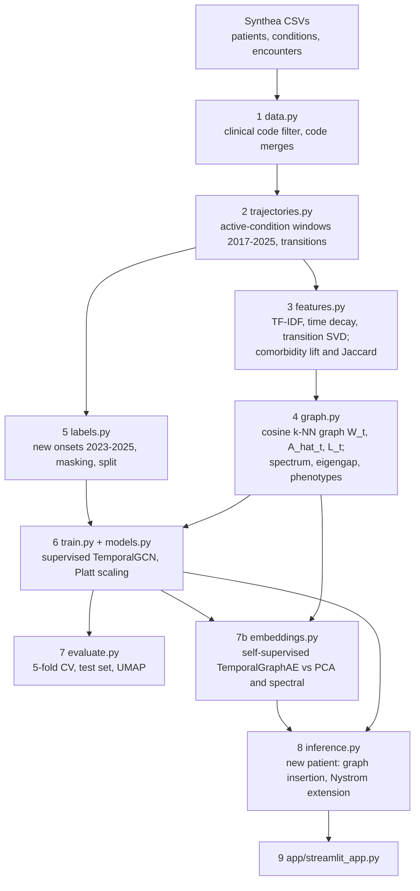

# Electronic health record networks: time-series embedding of comorbidity trajectories via linear-algebraic patient-similarity graphs

Each patient's history of chronic and acute conditions is turned into a yearly sequence of
feature vectors. Every year, patients are linked to their most similar patients in a cosine
k-nearest-neighbour graph, and the graphs are normalized and analysed with linear algebra
(TF-IDF, truncated SVD, the normalized adjacency and Laplacian, eigendecomposition). A temporal
graph convolutional network (a GCN shared across years, then a GRU over the years) embeds each
patient-year and each whole trajectory. The embeddings are judged on two jobs: **finding
clinically similar patients** and **forecasting new chronic conditions**.

Data: [Synthea](https://synthetichealth.github.io/synthea/) synthetic EHR, 3,000 patients,
SNOMED-CT condition codes. This is a research prototype on synthetic data, not for clinical use.

## The answer in four findings

From [reports/findings.md](reports/findings.md). Brackets are 95% percentile bootstrap intervals
over patients; a difference counts as shown only if its interval excludes 0.

1. **The similarity graphs carry clinical structure.** The same self-supervised graph
   autoencoder keeps 0.358 neighbour concordance on the real graphs but drops to 0.123, near
   chance (0.103), on degree-preserving rewired graphs (difference +0.235, +0.213 to +0.256).
   Who is linked to whom matters, not just how many links. The Laplacian spectrum of the 2022
   graph gives 7 phenotypes with coherent profiles (chronic pain in 98% of one cluster,
   obstructive sleep apnoea in 98% of another, at 40.7 times its overall rate).
2. **Linear-algebraic embeddings preserve comorbidity similarity best.** The spectral
   embedding (Laplacian eigenvectors) ranks first, 0.431 (0.408-0.455), then PCA of every
   window, 0.414. The neural TemporalGraphAE reaches 0.358, and the supervised TemporalGCN's
   embedding collapses (0.143; 99.8% of its variance on one direction).
3. **Per-year embeddings trace trajectories.** The GraphAE's state after each year moves
   through the embedding space as conditions accumulate, with later moves coinciding with new
   chronic onsets, and phenotypes occupy distinct regions.
4. **Forecasting new onsets is near chance on Synthea, for every method.** In 5-fold
   cross-validation all 8 models, from age and sex alone (0.554) to the full TemporalGCN
   (0.579), lie between 0.553 and 0.585 pooled AUROC, and no difference is shown. The final
   model scores 0.559 (0.483-0.632) on the held-out test set. This looks like a limit of the
   synthetic data rather than of the methods (see [Limitations](#limitations)).

## Pipeline



Timeline: the yearly windows 2017-2022 are the features; new onsets from 2023-01-01 to the end
of 2025 are the labels. Features never read anything on or after the cutoff 2023-01-01.

## How the title maps to the code

| Title phrase | Module | Output |
| --- | --- | --- |
| Electronic health record | [data.py](src/ehrgraph/data.py): read the CSVs, merge duplicate codes, keep clinical codes | `data/processed/events_clinical.parquet`, [data_summary.md](reports/data_summary.md), [clinical_summary.md](reports/clinical_summary.md) |
| comorbidity trajectories | [trajectories.py](src/ehrgraph/trajectories.py): active conditions per yearly window, transitions between onsets | `windows.npz`, `transitions.parquet`, [trajectories_summary.md](reports/trajectories_summary.md) |
| comorbidity (pairs) | [features.py](src/ehrgraph/features.py): co-occurrence counts, lift and Jaccard | `chronic_comorbidity_lift.npz`, [features_summary.md](reports/features_summary.md), heatmap |
| linear-algebraic (features) | [features.py](src/ehrgraph/features.py): TF-IDF, exponential time decay, transition matrices reduced by truncated SVD | `features/features_<year>.npz`, `artifacts/tfidf_idf.npy`, `transition_svd.npz` |
| patient-similarity graphs, networks | [graph.py](src/ehrgraph/graph.py): cosine k-NN graph, A_hat, Laplacian, eigengap, spectral embedding and clustering, drift | `graphs/W_<year>.npz`, `A_hat_<year>.npz`, `spectral_2022.npz`, [graphs_summary.md](reports/graphs_summary.md) |
| time-series embedding | [models.py](src/ehrgraph/models.py), [train.py](src/ehrgraph/train.py): TemporalGCN (supervised), TemporalGraphAE (self-supervised) | `artifacts/embeddings_per_window.npy` [N, T, d], `trajectory_embeddings.npy`, `embeddings_7b.npz` |
| (evaluation) | [labels.py](src/ehrgraph/labels.py), [evaluate.py](src/ehrgraph/evaluate.py), [embeddings.py](src/ehrgraph/embeddings.py) | [results.md](reports/results.md), [embedding_results.md](reports/embedding_results.md), [findings.md](reports/findings.md) |
| (use) | [inference.py](src/ehrgraph/inference.py), [app/streamlit_app.py](app/streamlit_app.py) | [predict_demo.md](reports/predict_demo.md), the app |

The mathematics is in [reports/methods.md](reports/methods.md); the report figures, numbered with
captions, are in [reports/figures/final/](reports/figures/final/captions.md).

## Setup (Windows, Anaconda)

From an Anaconda Prompt in the project folder:

```bat
conda create -n ehrgraph python=3.12 -y
conda activate ehrgraph
pip install -r requirements.txt
pip install -e .
```

Put the Synthea CSV export in `data/raw/`: `patients.csv`, `conditions.csv` and
`encounters.csv`. Older Synthea exports without the `MIDDLE`, `FIPS`, `INCOME` and `SYSTEM`
columns work: those columns are never read. Every parameter is in
[config/config.yaml](config/config.yaml), and every random seed is 42.

## Running

Everything from scratch, with the time per step (deletes `data/processed/` and `artifacts/`
first; writes [reports/run_all_timing.md](reports/run_all_timing.md)):

```bat
conda run -n ehrgraph python scripts/run_all.py
conda run -n ehrgraph python scripts/10_final_figures.py
```

`run_all.py` runs phases 1, 2, 3, 4, 5, 6a (the validation baselines that phase 6 compares
with), 6, 7, 7b, 9 and then the Phase 8 demo. It does not run the hyperparameter search
(`06b_tune.py`; its chosen setting is already in the `model` section of the config). The
individual steps:

```bat
conda run -n ehrgraph python scripts/01_prepare_data.py       :: events, code dictionary, data reports
conda run -n ehrgraph python scripts/02_build_trajectories.py :: yearly windows 2017-2025
conda run -n ehrgraph python scripts/03_build_features.py     :: features, comorbidity, model cohort
conda run -n ehrgraph python scripts/04_build_graphs.py       :: k-NN graphs, A_hat, spectrum, phenotypes
conda run -n ehrgraph python scripts/05_build_labels.py       :: onset labels and the split
conda run -n ehrgraph python scripts/06a_baselines.py         :: logistic-regression baselines (validation)
conda run -n ehrgraph python scripts/06b_tune.py              :: hyperparameter search (validation; optional)
conda run -n ehrgraph python scripts/06_train.py              :: final TemporalGCN and its calibration
conda run -n ehrgraph python scripts/07_evaluate.py           :: cross-validation, test set, embeddings
conda run -n ehrgraph python scripts/07b_embeddings.py        :: TemporalGraphAE and the embedding comparison
conda run -n ehrgraph python scripts/08_predict_demo.py       :: four example patients
conda run -n ehrgraph python scripts/09_app_assets.py         :: assets of the app
conda run -n ehrgraph python scripts/10_final_figures.py      :: numbered report figures at 300 dpi
```

The app and the tests:

```bat
conda run -n ehrgraph streamlit run app/streamlit_app.py
conda run -n ehrgraph python -m pytest --cov=ehrgraph --cov-report=term
```

The app's pages: overview (pipeline, dataset, findings), new patient, patient explorer,
comorbidity network, similarity graph over time, and embeddings and results. It trains
nothing: it loads the saved models and assets.

To score a new patient in Python (about 0.5 s to load, 0.25 s per patient):

```python
from ehrgraph.inference import NewPatient, Predictor

predictor = Predictor.load()
prediction = predictor.predict(NewPatient([(2018, "714628002"), (2019, "59621000")],
                                          birth_date="1972-06-01", sex="M"))
predictor.explain(prediction)  # the patient's chronic conditions over-represented nearby
```

### Reproducibility

One run of `run_all.py` from scratch (Windows 11, CPU only, 2026-10-31, before the Phase 8 demo
was added to it) took 15:29:

| Phase | Script | Time (m:ss) |
| --- | --- | ---: |
| 1-5 | `01_prepare_data.py` to `05_build_labels.py` | 0:22 |
| 6a | `06a_baselines.py` | 0:38 |
| 6 | `06_train.py` | 0:34 |
| 7 | `07_evaluate.py` (5 folds x 8 models, GCNs x 3 seeds) | 8:13 |
| 7b | `07b_embeddings.py` (9 tuning runs, 4 variants, 8 embeddings) | 4:58 |
| 9 | `09_app_assets.py` | 0:44 |

Every number in this README came out the same in that run. The processed data, features,
graphs, labels, final TemporalGCN, cross-validation and test predictions are byte-identical to
the previous run. The TemporalGraphAE is not bit-for-bit reproducible across runs (seeds fixed;
the cause, presumably floating-point non-determinism in training, was not investigated): its
states moved by up to 5e-5, a few interval bounds in `embedding_results.md` by 0.001, and its
UMAP layouts shifted without changing what they show.

## Data and cohort

| Step | Count |
| --- | ---: |
| Synthea patients | 3,000 |
| Condition events kept by the clinical code filter | 40,957 of 106,926 (223 of 296 codes) |
| Patients with at least 2 distinct clinical codes and a condition active in 2017-2025 | 2,646 |
| Model cohort: a non-empty feature row in some window 2017-2022 (graph nodes) | 2,581 |
| Feature vocabulary (codes) after dropping 10 redundant general codes | 204 |
| Patients with an observed `any_onset` label (positives) | 2,221 (414, 18.6%) |
| Train / validation / test patients with a label (positives) | 1,556 (290) / 335 (63) / 330 (61) |

The primary target `any_onset` is a new onset, in 2023-2025, of any of 9 chronic condition
groups (CKD, prediabetes, hypertension, ischaemic heart disease, metabolic syndrome,
hyperlipidaemia, obesity, chronic pain, substance use). Labels are 1, 0 or masked: a group the
patient already had before the cutoff is masked, as are patients who died before the cutoff,
were lost to follow-up, or died in the horizon without the onset. No label is derived from the
features (see [labels_summary.md](reports/labels_summary.md)).

## Results

### 1. The graph carries structure

The same self-supervised TemporalGraphAE trained on the real graphs, on rewired graphs (each
patient keeps their number of neighbours, partners random), and with no graph. Concordance: mean
Jaccard overlap of chronic conditions between a test patient and their 5 nearest neighbours in
the embedding; random patients score 0.103 (0.094-0.112).

| GraphAE trained on | Concordance | Real graph minus this |
| --- | ---: | ---: |
| Real similarity graphs | 0.358 (0.332-0.381) | |
| Rewired graphs (same degrees) | 0.123 (0.111-0.134) | +0.235 (+0.213 to +0.256) |
| No graph (A_hat = I) | 0.318 (0.297-0.340) | +0.040 (+0.020 to +0.060) |

### 2. Which embedding preserves similarity

All 32-dimensional; test patients; same bootstrap resamples, so differences are paired.

| Embedding | Graph | Training | Neighbour concordance | Next-year micro AUROC | Share of variance on PC1 |
| --- | --- | --- | ---: | ---: | ---: |
| Spectral (32 Laplacian eigenvectors, 2022) | real | none | **0.431** (0.408-0.455) | 0.713 | 3.1% |
| PCA, every window 2017-2022 | none | none | 0.414 (0.387-0.442) | 0.727 | 9.1% |
| GraphAE, link term only | real | self-supervised | 0.403 (0.379-0.426) | 0.742 | 24.0% |
| PCA, 2022 window | none | none | 0.394 (0.369-0.419) | 0.752 | 8.1% |
| TemporalGraphAE | real | self-supervised | 0.358 (0.332-0.381) | 0.755 | 64.7% |
| GraphAE, no graph | none | self-supervised | 0.318 (0.297-0.340) | 0.766 | 46.2% |
| Supervised TemporalGCN state | real | `any_onset` labels | 0.143 (0.130-0.156) | 0.753 | 99.8% |
| GraphAE, rewired graphs | random | self-supervised | 0.123 (0.111-0.134) | 0.769 | 83.2% |
| *Input features themselves (236-d)* | | | *0.503 (0.481-0.527)* | | |

The TemporalGraphAE is shown below the spectral embedding (-0.074, -0.095 to -0.055) and both
PCAs; spectral ranks first on its point estimate, but its interval overlaps PCA's. Next-year
micro AUROC (new conditions in 2022 from the 2021 embedding) is about the codes' base rates
alone, 0.760: every embedding ranks patients within a code at only 0.503-0.624.

### 3. Trajectories

The GraphAE's state after each year 2017-2022 traces each patient's path
([figure](reports/figures/ae_trajectories_umap.png)). The mean yearly step shrinks from 1.382
(2017 to 2018) to 0.267 (2021 to 2022); the long first steps are mostly the GRU settling as it
reads more years, and later moves coincide with new chronic onsets. Phenotypes 1, 2, 4 and 5
occupy distinct regions of the UMAP; the silhouette against the phenotypes is -0.012 (shuffled
labels -0.181).

### 4. Forecasting new onsets (`any_onset`, 2023-2025)

5-fold cross-validation on all 2,221 labelled patients (414 positives); GCNs averaged over seeds
42-44; Platt scaling fitted on an inner validation set in each fold.

| # | Model | Pooled out-of-fold AUROC | Full TemporalGCN minus this |
| ---: | --- | ---: | ---: |
| 2 | Logistic regression, 2022 window + age, sex | 0.585 (0.556-0.614) | -0.005 (-0.029 to +0.021) |
| 3 | Logistic regression, 6 windows + age, sex | 0.584 (0.554-0.611) | -0.005 (-0.032 to +0.023) |
| 6 | Temporal model, no graph | 0.583 (0.556-0.612) | -0.003 (-0.028 to +0.021) |
| 8 | **TemporalGCN (full)** | 0.579 (0.549-0.608) | reference |
| 5 | Static GCN (2022 only) | 0.556 (0.526-0.584) | +0.023 (-0.010 to +0.057) |
| 7 | TemporalGCN, rewired graphs | 0.556 (0.525-0.584) | +0.023 (-0.009 to +0.057) |
| 1 | Age and sex only | 0.554 (0.525-0.582) | +0.025 (-0.007 to +0.059) |
| 4 | Spectral embedding + logistic regression | 0.553 (0.522-0.580) | +0.027 (-0.002 to +0.054) |

Held-out test set, scored once with the final model of `06_train.py` (330 patients, 61
positives): AUROC 0.559 (0.483-0.632); Brier score 0.155 (0.129-0.180) against 0.151 for always
predicting the base rate. Its validation AUROC was 0.678, but the validation split chose the
hyperparameters and the epoch; the same model family scores 0.640 out of fold on these test
patients, so a single split's AUROC is noisy and the pooled cross-validated 0.579 is the
estimate to quote.

## Limitations

- **Synthetic data.** Synthea simulates care with fixed, rule-based disease modules. The results
  describe how the methods behave on such data, not on real records. Its modules appear to
  leave earlier conditions little information about later onsets beyond age and sex: age and
  sex alone are the best model for ischaemic heart disease (AUROC 0.88). This is a reading of
  the results, not something tested here.
- **10-year history window.** Synthea exports a complete record only for the 10 years before
  its run date (2026-10-30), so clinical events dated per year jump from about 400 to about
  2,500 at 2017 ([figure](reports/figures/active_patients_per_year.png)). The features cover six
  yearly windows (2017-2022); earlier conditions appear only if still active.
- **The risk-set effect.** `any_onset` is a NEW onset in any of 9 groups, and a group the
  patient already has is masked. A multimorbid patient has fewer groups left in which a new
  onset can occur, and so do their similar patients. A healthy patient's neighbours can
  therefore show a higher `any_onset` rate than a multimorbid patient's: 3/8 for a healthy young
  adult (at risk for 9 of 9 groups) against 3/10 for a multimorbid elderly patient (at risk for
  5) in [predict_demo.md](reports/predict_demo.md). `any_onset` measures new onsets, not
  disease burden.
- **Transductive training.** Every patient, test patients included, is a graph node with their
  pre-cutoff features during training (never their labels). The GraphAE's link term also
  reconstructs test patients' edges, which may favour graph-based embeddings in the test
  concordance comparison.
- **Inductive approximation.** A new patient is linked to their 10 nearest reference patients
  in each year's graph and only the affected rows of A_hat are re-normalized; the reference
  graph is not rebuilt, and the spectral coordinates come from the Nystrom extension.
- **Small N.** 61 test positives; 31-109 positives per onset group across all folds and 4-17
  on the test set; 122 next-year onsets over 12 codes. Group-level results are indicative
  only, and the intervals omit retraining (seed) variation. The GCN hyperparameters were tuned
  on the validation split, whose patients are also in the cross-validation folds, so the
  cross-validated GCN numbers are slightly optimistic.

## Future work

- **Real data.** Run the same pipeline on MIMIC-IV (or a primary-care EHR) with ICD-10 codes,
  longer histories and real follow-up, and validate on an external cohort. The question is
  whether real records hold the temporal dependencies between conditions that Synthea's modules
  appear to lack; only then can the temporal and graph components show their value for
  forecasting.
- **Temporal models.** Attention over the yearly states (a transformer, or time-aware attention
  with irregular intervals) instead of the GRU, and finer windows than one year.
- **Inductive graphs.** Train with patients held out of the graph (GraphSAGE-style sampling)
  so that a new patient is scored exactly as the training patients were.
- **Targets.** Per-group survival models (time to onset) with the risk set explicit, instead of
  a pooled binary `any_onset`.

## Repository layout

```
config/config.yaml        every parameter, seeds (42) and paths
src/ehrgraph/             data, trajectories, features, graph, labels, models, train,
                          evaluate, embeddings, inference, config, utils
scripts/                  01-10 phase scripts, run_all.py
tests/                    pytest suite (unit tests on tiny graphs; integration tests on the saved outputs)
app/streamlit_app.py      the app
data/raw/                 Synthea CSVs (not in version control)
data/processed/, artifacts/   pipeline outputs (regenerated by run_all.py)
reports/                  reports, findings.md, methods.md, viva_questions.md, figures/
```
