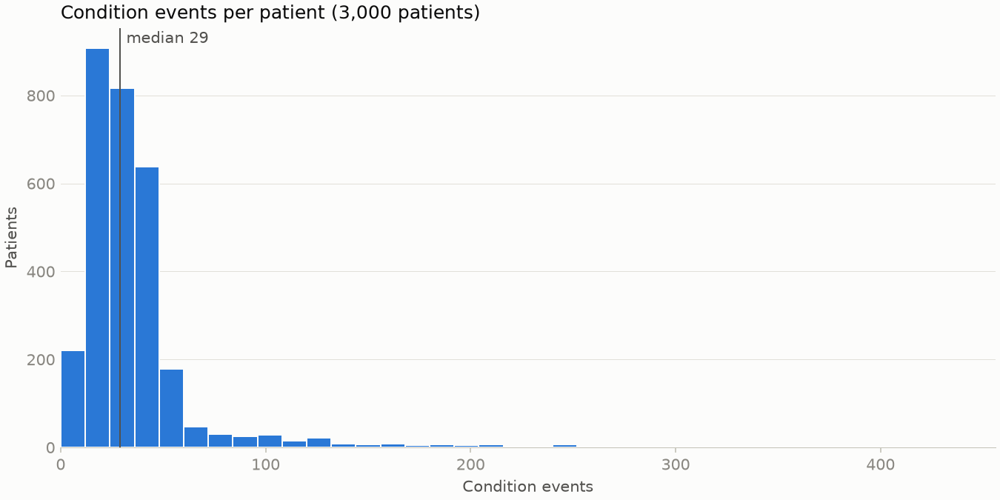

# Data summary

Synthea synthetic EHR, prepared by `scripts/01_prepare_data.py`. A condition event is one row of conditions.csv, dated by its encounter's START (UTC).

## Patients

| Status | Patients | Share |
| --- | ---: | ---: |
| Alive | 2,624 | 87.5% |
| Deceased | 376 | 12.5% |
| Total | 3,000 | 100.0% |

### Gender

| Gender | Patients | Share |
| --- | ---: | ---: |
| F | 1,511 | 50.4% |
| M | 1,489 | 49.6% |

### Age

Completed years at death for deceased patients, otherwise on 2026-10-30 (the last event date in the data). Mean 42.0, median 42, range 0 to 110.

| Age group | Patients | Share |
| --- | ---: | ---: |
| 0-17 | 571 | 19.0% |
| 18-29 | 485 | 16.2% |
| 30-44 | 526 | 17.5% |
| 45-64 | 837 | 27.9% |
| 65-79 | 403 | 13.4% |
| 80+ | 178 | 5.9% |

## Condition events

| Measure | Value |
| --- | ---: |
| Events | 106,926 |
| Unique condition codes (SNOMED-CT) | 296 |
| Date range | 1919-12-19 to 2026-10-30 |
| Events per patient, mean | 35.6 |
| Events per patient, median | 29 |
| Events per patient, max | 453 |
| Patients with no events | 0 |

## Top 20 conditions

Ranked by the number of patients with at least one event of the code (ties by event count). Each description is the code's most frequent wording in the data.

| Rank | Code | Description | Patients | Share of patients | Events |
| ---: | --- | --- | ---: | ---: | ---: |
| 1 | 314529007 | Medication review due (situation) | 3,000 | 100.0% | 20,722 |
| 2 | 66383009 | Gingivitis (disorder) | 2,392 | 79.7% | 7,799 |
| 3 | 73595000 | Stress (finding) | 2,365 | 78.8% | 8,203 |
| 4 | 160903007 | Full-time employment (finding) | 2,365 | 78.8% | 7,717 |
| 5 | 444814009 | Viral sinusitis (disorder) | 1,901 | 63.4% | 3,028 |
| 6 | 160904001 | Part-time employment (finding) | 1,899 | 63.3% | 4,841 |
| 7 | 423315002 | Limited social contact (finding) | 1,673 | 55.8% | 3,092 |
| 8 | 422650009 | Social isolation (finding) | 1,640 | 54.7% | 2,989 |
| 9 | 224299000 | Received higher education (finding) | 1,462 | 48.7% | 1,462 |
| 10 | 18718003 | Gingival disease (disorder) | 1,419 | 47.3% | 2,349 |
| 11 | 162864005 | Body mass index 30+ - obesity (finding) | 1,409 | 47.0% | 1,409 |
| 12 | 741062008 | Not in labor force (finding) | 1,404 | 46.8% | 2,654 |
| 13 | 195662009 | Acute viral pharyngitis (disorder) | 1,323 | 44.1% | 1,742 |
| 14 | 706893006 | Victim of intimate partner abuse (finding) | 1,302 | 43.4% | 1,934 |
| 15 | 10509002 | Acute bronchitis (disorder) | 1,186 | 39.5% | 1,478 |
| 16 | 109570002 | Primary dental caries (disorder) | 1,181 | 39.4% | 1,707 |
| 17 | 714628002 | Prediabetes (finding) | 1,142 | 38.1% | 1,142 |
| 18 | 271737000 | Anemia (disorder) | 1,048 | 34.9% | 1,048 |
| 19 | 424393004 | Reports of violence in the environment (finding) | 1,019 | 34.0% | 1,599 |
| 20 | 73438004 | Unemployed (finding) | 935 | 31.2% | 1,128 |

## Validation

Hard checks make `validate()` raise; soft checks are logged and their rows kept. events_in_future counts events after the reference date, which by default is the latest event date in the data rather than today.

| Check | Kind | Count |
| --- | --- | ---: |
| duplicate_patient_ids | hard | 0 |
| events_missing_fields | hard | 0 |
| events_unknown_patient | hard | 0 |
| events_after_death | soft | 0 |
| events_in_future | soft | 0 |
