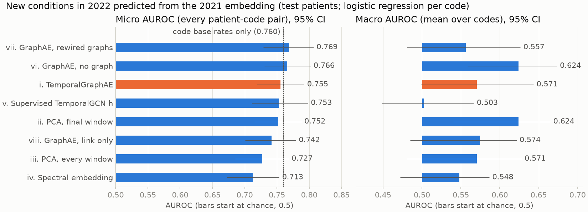
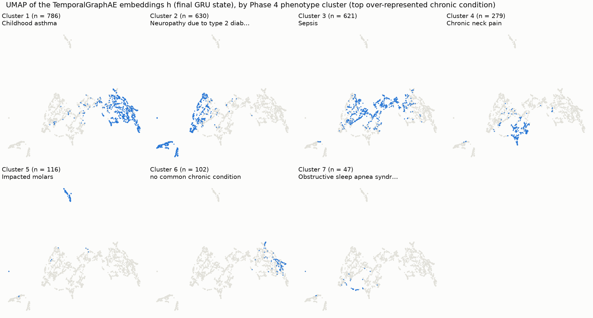
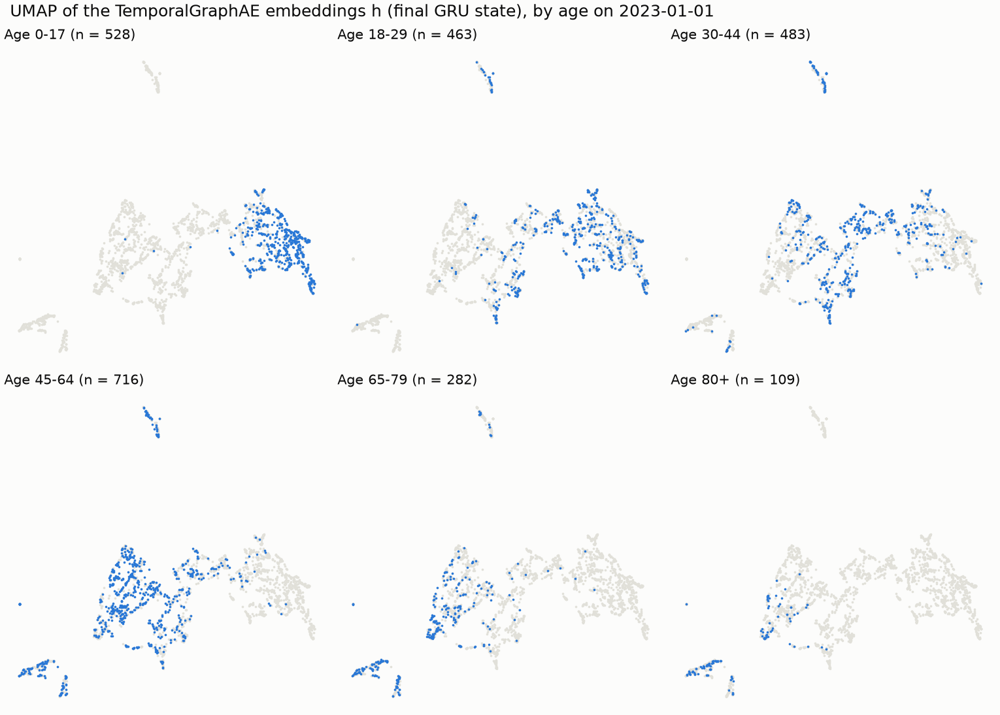
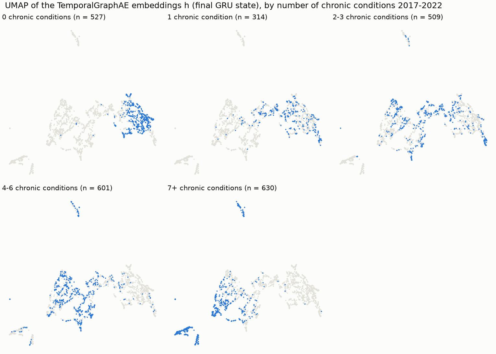
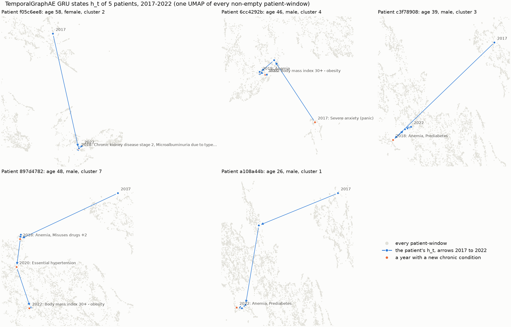

# Embedding results (Phase 7b)

Built by `scripts/07b_embeddings.py`. Plain-language findings: `embedding_summary.md`. Every number below is on test-split patients unless noted; intervals are 95% percentile bootstrap intervals over those patients (1000 resamples, seed 42), and every embedding is scored on the same resamples, so differences are paired. A difference marked **shown** has an interval that excludes 0.

## Setup

- **TemporalGraphAE** (`models.TemporalGraphAE`): the TemporalGCN encoder (shared 2-layer GCN per window, 64 -> 32, dropout 0.5; GRU with 32 units), no demographics, no onset labels. Loss = link + 2 x next-window. **Link:** per window, `sigmoid(z_i . z_j)` on Z_t for that window's k-NN edges against as many uniformly drawn non-edges between nodes with an edge (fresh each epoch), BCE, averaged over windows. **Next window:** a linear decoder from the GRU state after window t to the codes active in window t + 1 (the 204 codes of the feature code block), pairs 2017->2018 to 2021->2022 only, BCE with `pos_weight` = negatives / positives per code on the training split; a patient not yet born or already dead at the start of window t + 1 is left out of that pair.
- **Who enters which loss:** every patient is a node and passes messages, and every edge enters the link term, test patients included. Only training-split patients' next-window terms enter the loss; validation-split patients' next-window loss picks the epoch (early stopping, patience 20); test-split patients' next-window targets enter no loss, so the 2021 -> 2022 evaluation on them is clean of that objective. Adam, lr 0.01, weight decay 0.0005, gradient norm clipped at 1.0, at most 300 epochs, seed 42.
- **Embeddings (all 32-d):** **i** TemporalGraphAE: final GRU state over 6 windows 2017-2022, on the similarity graphs; **ii** PCA, final window: 32 principal components of the 2022 input features; **iii** PCA, every window: 32 principal components of the 6 windows 2017-2022 concatenated; **iv** Spectral embedding: first 32 non-trivial normalized-Laplacian eigenvectors of the 2022 graph (largest component; other nodes 0); **v** Supervised TemporalGCN h: the Phase 6/7 final model's GRU state; **vi** GraphAE, no graph: A_hat = I in every window, so no message passing and no edges for the link term; **vii** GraphAE, rewired graphs: every window's graph rewired by degree-preserving double edge swaps (Phase 7 model 7's graphs); **viii** GraphAE, link only: no next-window gradient: only the link term trains the encoder; the GRU stays as initialized.
- **2021 versions:** for the next-year task each embedding is recomputed from the windows up to 2021 only: the GRU state after 2021 (i, v-viii), PCA of the 2021 window (ii) or of 2017-2021 concatenated (iii), the spectral embedding of the 2021 graph (iv).

## Choosing the next-window weight (validation only)

Each weight in {0.5, 1, 2} trained with seeds 42, 43, 44, embed_dim 32; chosen by the lowest mean validation next-window loss (the unweighted BCE, comparable across weights). **Chosen: 2.** Test patients were not used.

| Next-window weight | Val next-window loss, mean +/- sd | Best epoch (mean) | Link AUROC (mean) | PC1 share (mean) |
| --- | ---: | ---: | ---: | ---: |
| 2 (chosen) | 1.0897 +/- 0.0223 | 36 | 0.953 | 52.6% |
| 1 | 1.1056 +/- 0.0282 | 37 | 0.957 | 56.9% |
| 0.5 | 1.1197 +/- 0.0402 | 40 | 0.962 | 63.4% |

| Weight | Seed | Best epoch | Epochs run | Val next loss | Train next loss | Link AUROC | PC1 share |
| ---: | ---: | ---: | ---: | ---: | ---: | ---: | ---: |
| 0.5 | 42 | 43 | 63 | 1.0781 | 0.8305 | 0.964 | 55.6% |
| 0.5 | 43 | 37 | 57 | 1.1582 | 0.8730 | 0.961 | 69.9% |
| 0.5 | 44 | 41 | 61 | 1.1229 | 0.8478 | 0.962 | 64.6% |
| 1 | 42 | 34 | 54 | 1.0776 | 0.8221 | 0.958 | 55.3% |
| 1 | 43 | 23 | 43 | 1.1340 | 0.9411 | 0.948 | 68.5% |
| 1 | 44 | 54 | 74 | 1.1052 | 0.7104 | 0.965 | 47.1% |
| 2 | 42 | 23 | 43 | 1.0645 | 0.8991 | 0.942 | 64.7% |
| 2 | 43 | 43 | 63 | 1.0977 | 0.7155 | 0.960 | 42.9% |
| 2 | 44 | 41 | 61 | 1.1069 | 0.7278 | 0.957 | 50.1% |

## The four GraphAE variants (seed 42, next-window weight 2)

Link AUROC: edges vs one fixed draw of non-edges, by `z_i . z_j`, mean over windows. PC1 share: the share of the final GRU states' variance on their first principal component, all patients (the supervised h, v: 99.8%).

| Variant | Best epoch | Epochs run | Val next loss | Link AUROC | PC1 share | Seconds |
| --- | ---: | ---: | ---: | ---: | ---: | ---: |
| i. TemporalGraphAE | 23 | 43 | 1.0645 | 0.942 | 64.7% | 12 |
| vi. GraphAE, no graph | 30 | 50 | 0.8623 | n/a (no edges) | 46.2% | 4 |
| vii. GraphAE, rewired graphs | 45 | 65 | 1.1528 | 0.598 | 83.2% | 16 |
| viii. GraphAE, link only | 53 | 73 | 1.1226 | 0.967 | 24.0% | 19 |

Anti-collapse check of the final GraphAE, logged during training (all patients):

| Epoch | PC1 share of h | Link AUROC | Val next loss |
| ---: | ---: | ---: | ---: |
| 1 | 33.6% | 0.829 | 1.2433 |
| 10 | 83.0% | 0.906 | 1.1457 |
| 20 | 66.4% | 0.938 | 1.0688 |
| 30 | 54.0% | 0.950 | 1.0678 |
| 40 | 49.2% | 0.959 | 1.1027 |

## Main table

Next year: new conditions in 2022 from the 2021 embedding, 12 codes, 3,436 test patient-code pairs at risk (122 onsets); the codes' base rates alone give a micro AUROC of 0.760 (see below). Concordance: Jaccard of chronic conditions with the 5 nearest neighbours (cosine). Silhouette and Davies-Bouldin: against the Phase 4 phenotypes (test patients in a cluster). PC1 share: all patients. Probe: pooled out-of-fold AUROC of `any_onset`, all 2,221 patients with a label (5 folds).

| Embedding | Graph | Trained by | Next-year micro AUROC (95% CI) | Macro AUROC (95% CI) | Neighbour concordance (95% CI) | Silhouette | Davies-Bouldin | PC1 share | Probe AUROC (95% CI) | Probe minus model 2 |
| --- | --- | --- | ---: | ---: | ---: | ---: | ---: | ---: | ---: | ---: |
| i. TemporalGraphAE | real | self-supervised: link + next-window | 0.755 (0.719 to 0.792) | 0.571 (0.499 to 0.643) | 0.358 (0.332 to 0.381) | -0.012 | 1.92 | 64.7% | 0.581 (0.550 to 0.609) | -0.004 (-0.035 to +0.027) |
| ii. PCA, final window | none | none (unsupervised) | 0.752 (0.715 to 0.788) | 0.624 (0.540 to 0.665) | 0.394 (0.369 to 0.419) | 0.055 | 3.16 | 8.1% | 0.575 (0.546 to 0.605) | -0.010 (-0.030 to +0.010) |
| iii. PCA, every window | none | none (unsupervised) | 0.727 (0.685 to 0.768) | 0.571 (0.481 to 0.628) | 0.414 (0.387 to 0.442) | -0.001 | 3.08 | 9.1% | 0.558 (0.528 to 0.589) | -0.027 (-0.050 to -0.003) |
| iv. Spectral embedding | real (2022 only) | none (unsupervised) | 0.713 (0.672 to 0.753) | 0.548 (0.472 to 0.587) | 0.431 (0.408 to 0.455) | 0.058 | 2.89 | 3.1% | 0.562 (0.533 to 0.592) | -0.023 (-0.048 to +0.004) |
| v. Supervised TemporalGCN h | real | supervised: any_onset (training split) * | 0.753 (0.712 to 0.798) | 0.503 (0.448 to 0.567) | 0.143 (0.130 to 0.156) | -0.388 | 11.67 | 99.8% | 0.691 (0.667 to 0.714) * | +0.106 (+0.080 to +0.132) |
| vi. GraphAE, no graph | none | self-supervised: next-window only | 0.766 (0.731 to 0.802) | 0.624 (0.559 to 0.673) | 0.318 (0.297 to 0.340) | -0.067 | 2.24 | 46.2% | 0.531 (0.500 to 0.563) | -0.054 (-0.091 to -0.019) |
| vii. GraphAE, rewired graphs | random | self-supervised: link + next-window | 0.769 (0.729 to 0.807) | 0.557 (0.481 to 0.627) | 0.123 (0.111 to 0.134) | -0.257 | 10.21 | 83.2% | 0.468 (0.437 to 0.501) | -0.117 (-0.160 to -0.074) |
| viii. GraphAE, link only | real | self-supervised: link only | 0.742 (0.701 to 0.779) | 0.574 (0.485 to 0.622) | 0.403 (0.379 to 0.426) | 0.048 | 2.17 | 24.0% | 0.586 (0.556 to 0.615) | +0.001 (-0.027 to +0.027) |

\* v was trained on the `any_onset` labels of the training split, who are in the probe's held-out folds: its probe AUROC is optimistic. Its clean cross-validated AUROC is Phase 7's model 8: 0.579 (0.549 to 0.608).

## The questions: paired differences (i minus the other)

Positive: the GraphAE is better (for concordance and AUROC, higher is better).

| Question | Comparison | Next-year micro AUROC | Next-year macro AUROC | Neighbour concordance | Probe AUROC |
| --- | --- | --- | --- | --- | --- |
| Does the graph help? | i - vi. GraphAE, no graph | -0.010 (-0.041 to +0.019) | -0.054 (-0.129 to +0.036) | +0.040 (+0.020 to +0.060) **shown** | +0.050 (+0.009 to +0.085) **shown** |
| Is the real graph better than a random one? | i - vii. GraphAE, rewired graphs | -0.013 (-0.044 to +0.017) | +0.014 (-0.090 to +0.121) | +0.235 (+0.213 to +0.256) **shown** | +0.113 (+0.072 to +0.154) **shown** |
| Does the temporal (next-window) objective help? | i - viii. GraphAE, link only | +0.014 (-0.008 to +0.034) | -0.004 (-0.046 to +0.084) | -0.046 (-0.062 to -0.030) **shown** | -0.005 (-0.036 to +0.025) |
| Does the GraphAE beat PCA of the final window? | i - ii. PCA, final window | +0.003 (-0.023 to +0.028) | -0.054 (-0.109 to +0.047) | -0.036 (-0.053 to -0.019) **shown** | +0.006 (-0.029 to +0.038) |
| Does the GraphAE beat PCA of every window? | i - iii. PCA, every window | +0.028 (-0.001 to +0.058) | +0.000 (-0.054 to +0.087) | -0.057 (-0.077 to -0.037) **shown** | +0.023 (-0.011 to +0.052) |
| Does the GraphAE beat the spectral embedding? | i - iv. Spectral embedding | +0.043 (+0.017 to +0.068) **shown** | +0.023 (-0.042 to +0.116) | -0.074 (-0.095 to -0.055) **shown** | +0.019 (-0.010 to +0.046) |
| Does the GraphAE beat the supervised TemporalGCN's h? | i - v. Supervised TemporalGCN h | +0.002 (-0.032 to +0.037) | +0.068 (-0.036 to +0.165) | +0.215 (+0.189 to +0.240) **shown** | -0.110 (-0.142 to -0.080) **shown** |

## Next-year new conditions

A code counts as new in 2022 for a patient whose first-ever event of it falls in 2022; patients with an earlier event of it, not yet born or already dead on 2022-01-01 are not at risk of it. Codes with at least 20 new onsets among training-split patients at risk are kept. One logistic regression per code (C 1.0, unweighted classes, inputs standardized on the training split) is fitted on training-split patients at risk and scored on test-split patients at risk. Micro AUROC pools every test (patient, code) pair; macro averages the per-code AUROC over the codes with a test onset. Bootstrap resamples with both classes: 1000.

**Read the micro AUROC against the codes' base rates.** Scoring every patient by each code's training onset rate, with no patient information at all, already gives a micro AUROC of 0.760 (0.719 to 0.802) (macro 0.5 by construction): pooling codes rewards knowing which codes are common. The GraphAE minus base rates: -0.005 (-0.034 to +0.026). The macro AUROC, the ranking of patients within each code, is the measure of what an embedding knows about the patient.

| Condition | Train onsets | Test onsets / at risk | i | ii | iii | iv | v | vi | vii | viii |
| --- | ---: | ---: | ---: | ---: | ---: | ---: | ---: | ---: | ---: | ---: |
| Viral sinusitis | 119 | 22 / 205 | 0.58 | 0.55 | 0.58 | 0.56 | 0.43 | 0.65 | 0.57 | 0.64 |
| Gingivitis | 96 | 22 / 139 | 0.51 | 0.57 | 0.53 | 0.46 | 0.68 | 0.67 | 0.55 | 0.51 |
| Gingival disease | 81 | 17 / 264 | 0.47 | 0.50 | 0.41 | 0.43 | 0.51 | 0.47 | 0.56 | 0.40 |
| Acute bronchitis | 73 | 16 / 301 | 0.39 | 0.47 | 0.42 | 0.38 | 0.41 | 0.51 | 0.48 | 0.44 |
| Acute viral pharyngitis | 73 | 13 / 282 | 0.50 | 0.60 | 0.60 | 0.56 | 0.55 | 0.58 | 0.60 | 0.52 |
| Primary dental caries | 70 | 16 / 291 | 0.68 | 0.58 | 0.64 | 0.53 | 0.44 | 0.52 | 0.39 | 0.52 |
| Streptococcal sore throat | 27 | 3 / 353 | 0.58 | 0.60 | 0.53 | 0.67 | 0.63 | 0.86 | 0.68 | 0.47 |
| Unhealthy alcohol drinking behavior | 25 | 1 / 333 | 0.17 | 0.80 | 0.63 | 0.71 | 0.34 | 0.47 | 0.72 | 0.73 |
| Acute infective cystitis | 23 | 2 / 358 | 0.82 | 0.78 | 0.82 | 0.50 | 0.25 | 0.64 | 0.51 | 0.56 |
| Body mass index 30+ - obesity | 22 | 2 / 204 | 0.65 | 0.46 | 0.38 | 0.49 | 0.57 | 0.59 | 0.38 | 0.60 |
| Polyp of colon | 21 | 1 / 360 | 0.88 | 0.97 | 0.92 | 0.82 | 0.61 | 0.94 | 0.56 | 0.98 |
| Infection of tooth | 20 | 7 / 346 | 0.62 | 0.61 | 0.38 | 0.48 | 0.62 | 0.59 | 0.68 | 0.52 |

## Neighbour concordance

For each test patient with a chronic condition (2017-2022, as in Phase 7): the mean Jaccard index of their chronic conditions with each of their 5 nearest neighbours by cosine distance, searched among all patients. References: random other patients, and the 2022 input features (the neighbours that build the graph).

| Representation | Concordance (95% CI) | i minus this |
| --- | ---: | ---: |
| i. TemporalGraphAE | 0.358 (0.332 to 0.381) |  |
| ii. PCA, final window | 0.394 (0.369 to 0.419) | -0.036 (-0.053 to -0.019) **shown** |
| iii. PCA, every window | 0.414 (0.387 to 0.442) | -0.057 (-0.077 to -0.037) **shown** |
| iv. Spectral embedding | 0.431 (0.408 to 0.455) | -0.074 (-0.095 to -0.055) **shown** |
| v. Supervised TemporalGCN h | 0.143 (0.130 to 0.156) | +0.215 (+0.189 to +0.240) **shown** |
| vi. GraphAE, no graph | 0.318 (0.297 to 0.340) | +0.040 (+0.020 to +0.060) **shown** |
| vii. GraphAE, rewired graphs | 0.123 (0.111 to 0.134) | +0.235 (+0.213 to +0.256) **shown** |
| viii. GraphAE, link only | 0.403 (0.379 to 0.426) | -0.046 (-0.062 to -0.030) **shown** |
| Random other patients (chance) | 0.103 (0.094 to 0.112) |  |
| 2022 input features (the graph's neighbours) | 0.503 (0.481 to 0.527) |  |

## Phenotype separation

Euclidean silhouette (higher is better, in [-1, 1]) and Davies-Bouldin index (lower is better) of the final embeddings against the 7 Phase 4 phenotype clusters, test patients in a cluster. The last row shuffles the clusters (chance). The phenotypes were found by k-means on the 2022 graph's Laplacian eigenvectors, so iv is scored against clusters derived from itself.

| Representation | Silhouette | Davies-Bouldin |
| --- | ---: | ---: |
| i. TemporalGraphAE | -0.012 | 1.92 |
| ii. PCA, final window | 0.055 | 3.16 |
| iii. PCA, every window | -0.001 | 3.08 |
| iv. Spectral embedding | 0.058 | 2.89 |
| v. Supervised TemporalGCN h | -0.388 | 11.67 |
| vi. GraphAE, no graph | -0.067 | 2.24 |
| vii. GraphAE, rewired graphs | -0.257 | 10.21 |
| viii. GraphAE, link only | 0.048 | 2.17 |
| i. TemporalGraphAE, clusters shuffled (chance) | -0.181 | 17.04 |

## Linear probe of any_onset

Phase 7's protocol and folds: 5-fold cross-validation over every patient with an `any_onset` label; per fold, logistic regression (the `baselines` settings) on the standardized embedding + age at the cutoff and sex, fitted on the inner training patients and Platt-calibrated on the inner validation patients (15%). Refitted here with the Phase 7 code and folds, model 2 reproduces Phase 7's saved out-of-fold probabilities (largest difference 0.0e+00).

| Probe | Pooled OOF AUROC (95% CI) | Minus model 2 | Folds with Platt slope <= 0 | Mean within-fold AUROC, uncalibrated |
| --- | ---: | ---: | ---: | ---: |
| i. TemporalGraphAE | 0.581 (0.550 to 0.609) | -0.004 (-0.035 to +0.027) | 0 of 5 | 0.586 |
| ii. PCA, final window | 0.575 (0.546 to 0.605) | -0.010 (-0.030 to +0.010) | 0 of 5 | 0.577 |
| iii. PCA, every window | 0.558 (0.528 to 0.589) | -0.027 (-0.050 to -0.003) **shown** | 0 of 5 | 0.561 |
| iv. Spectral embedding | 0.562 (0.533 to 0.592) | -0.023 (-0.048 to +0.004) | 0 of 5 | 0.563 |
| v. Supervised TemporalGCN h * | 0.691 (0.667 to 0.714) | +0.106 (+0.080 to +0.132) **shown** | 0 of 5 | 0.693 |
| vi. GraphAE, no graph | 0.531 (0.500 to 0.563) | -0.054 (-0.091 to -0.019) **shown** | 1 of 5 | 0.539 |
| vii. GraphAE, rewired graphs | 0.468 (0.437 to 0.501) | -0.117 (-0.160 to -0.074) **shown** | 3 of 5 | 0.546 |
| viii. GraphAE, link only | 0.586 (0.556 to 0.615) | +0.001 (-0.027 to +0.027) | 0 of 5 | 0.585 |
| Phase 7 model 2 (2022 features + age, sex) | 0.585 (0.556 to 0.614) | reference | 0 of 5 | 0.587 |

A Platt slope <= 0 means the inner validation patients ranked the other way, so the calibration reverses that fold's ranking; the pooled AUROC (the Phase 7 protocol) keeps that reversal. The last column, the mean of the folds' AUROCs of the uncalibrated logits, is not affected by calibration; it is a check, not a replacement.

## Seed sensitivity of the GraphAE

The chosen setting (weight 2) retrained with each tuning seed: next-year micro AUROC on the test patients and PC1 share. The bootstrap intervals above do not include this variation.

| Seed | Next-year micro AUROC | PC1 share |
| ---: | ---: | ---: |
| 42 | 0.755 | 64.7% |
| 43 | 0.742 | 42.9% |
| 44 | 0.741 | 50.1% |

## Figures

Trajectories: the GRU state h_t after each window 2017-2022 (one UMAP of every non-empty patient-window) for the 5 example patients of Phase 7. Mean step ||h_{t+1} - h_t|| in the 32-d space, over patients with features in every window: 2017->2018 1.382, 2018->2019 0.833, 2019->2020 0.490, 2020->2021 0.333, 2021->2022 0.267. The early steps are the longest: the state settles as the GRU reads more windows (and the time-decayed cumulative features change less each year), so the long early moves in the figure are mostly that settling, not clinical change.

