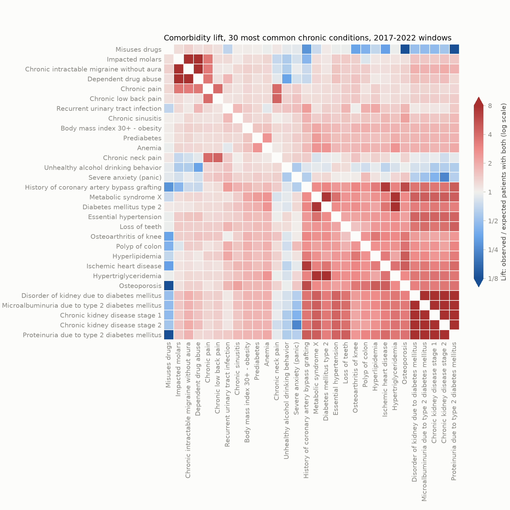

# Patient features and comorbidity

Built by `scripts/03_build_features.py` from the Phase 2 windows and trajectories. Each window's features are `[X_cum_t | transition_svd_t]`, row L2-normalized.

## Settings

| Setting | Value |
| --- | ---: |
| Patients x feature codes | 2,646 x 205 (9 redundant codes dropped) |
| Windows | 2017-2025 |
| Training-period windows (model inputs, IDF fit, comorbidity) | 2017-2022, before the cutoff 2023-01-01 |
| IDF documents (non-empty patient-windows in the training period) | 13,257 |
| TF-IDF row norm | l2 |
| Time decay lambda (weight of a window t - s years old) | 0.1 (exp(-lambda) = 0.905 per year) |
| Transition SVD | fit on the 2022 block: 205^2 = 42,025 -> 32 components, 24.6% of the variance (first 1.7%) |
| Transition block weight | 1 |

Each block is row-L2-normalized before concatenation and the transition block scaled by its weight, so with both present it holds 50% of each row's squared norm. Window t's transition block uses only transitions that end by the end of year t and before the cutoff; the SVD basis is fit once, on the 2022 block, like the IDF on the whole training period.

## Redundant general codes

Dropped from the feature vocabulary (code block, transitions, chronic comorbidity): at 95% or more of their encounters a more specific code is also recorded. A code is more specific if it is recorded with the general one at 95% or more of its own encounters and is no more common. Patients are cohort patients with the code at any date.

| Code | Condition | Patients | Encounters | With a more specific code | More specific codes |
| --- | --- | ---: | ---: | ---: | --- |
| 125605004 | Fracture of bone (disorder) | 398 | 434 | 100.0% | Fracture of forearm, Fracture of clavicle, Fracture of ankle, Fracture subluxation of wrist, Osteoporotic fracture of bone, Fracture of rib, Closed fracture of hip |
| 384709000 | Sprain (morphologic abnormality) | 364 | 395 | 100.0% | Sprain of ankle, Sprain of wrist |
| 312608009 | Laceration - injury (disorder) | 352 | 375 | 100.0% | Laceration of hand, Facial laceration, Laceration of foot, Laceration of thigh, Laceration of forearm |
| 19169002 | Miscarriage in first trimester (disorder) | 125 | 147 | 100.0% | Complete miscarriage, Blighted ovum, Tubal pregnancy |
| 90460009 | Injury of neck (disorder) | 117 | 119 | 100.0% | Whiplash injury to neck |
| 125601008 | Injury of knee (disorder) | 53 | 53 | 100.0% | Rupture of patellar tendon, Injury of medial collateral ligament of knee, Injury of anterior cruciate ligament, Tear of meniscus of knee |
| 126906006 | Neoplasm of prostate (disorder) | 31 | 31 | 100.0% | Carcinoma in situ of prostate, Metastatic malignant neoplasm to prostate |
| 48333001 | Burn injury (morphologic abnormality) | 112 | 116 | 99.1% | Epidermal burn of skin, Partial thickness burn, Full thickness burn |
| 110030002 | Concussion injury of brain (disorder) | 201 | 210 | 95.7% | Concussion with no loss of consciousness, Concussion with loss of consciousness |

These also meet the rule but are kept, as they are not general forms of the codes recorded with them (see config.yaml):

| Code | Condition | Patients | Encounters | With a more specific code | More specific codes |
| --- | --- | ---: | ---: | ---: | --- |
| 85116003 | Miscarriage in second trimester (disorder) | 27 | 28 | 100.0% | Fetus with chromosomal abnormality, Congenital uterine anomaly, Complication occurring during pregnancy |
| 128188000 | Cerebral palsy (disorder) | 9 | 9 | 100.0% | Gastroesophageal reflux disease, Intellectual disability, Excessive salivation, Dystonia, Dislocation of hip joint |
| 235919008 | Gallbladder calculus (disorder) | 8 | 8 | 100.0% | Acute cholecystitis |
| 65275009 | Acute cholecystitis (disorder) | 8 | 8 | 100.0% | Gallbladder calculus |
| 262574004 | Bullet wound (disorder) | 6 | 6 | 100.0% | Gunshot wound |
| 283545005 | Gunshot wound (disorder) | 6 | 6 | 100.0% | Bullet wound |
| 234466008 | Acquired coagulation disorder (disorder) | 2 | 2 | 100.0% | Injury of kidney, Heart failure, Injury of heart, Bacterial infectious disease |
| 40095003 | Injury of kidney (disorder) | 2 | 2 | 100.0% | Acquired coagulation disorder, Heart failure, Injury of heart, Bacterial infectious disease |
| 1734006 | Fracture of vertebral column with spinal cord injury (disorder) | 1 | 1 | 100.0% | Traumatic injury of spinal cord and/or vertebral column, Chronic paralysis due to lesion of spinal cord |
| 230745008 | Hydrocephalus (disorder) | 1 | 1 | 100.0% | Scoliosis deformity of spine, Congenital deformity of foot, Chiari malformation type II, Kyphosis deformity of spine, Meningomyelocele |
| 262521009 | Traumatic injury of spinal cord and/or vertebral column (disorder) | 1 | 1 | 100.0% | Fracture of vertebral column with spinal cord injury, Chronic paralysis due to lesion of spinal cord |
| 298382003 | Scoliosis deformity of spine (disorder) | 1 | 1 | 100.0% | Hydrocephalus, Congenital deformity of foot, Chiari malformation type II, Kyphosis deformity of spine, Meningomyelocele |
| 302297009 | Congenital deformity of foot (disorder) | 1 | 1 | 100.0% | Hydrocephalus, Scoliosis deformity of spine, Chiari malformation type II, Kyphosis deformity of spine, Meningomyelocele |
| 373587001 | Chiari malformation type II (disorder) | 1 | 1 | 100.0% | Hydrocephalus, Scoliosis deformity of spine, Congenital deformity of foot, Kyphosis deformity of spine, Meningomyelocele |
| 414564002 | Kyphosis deformity of spine (disorder) | 1 | 1 | 100.0% | Hydrocephalus, Scoliosis deformity of spine, Congenital deformity of foot, Chiari malformation type II, Meningomyelocele |
| 414667000 | Meningomyelocele (disorder) | 1 | 1 | 100.0% | Hydrocephalus, Scoliosis deformity of spine, Congenital deformity of foot, Chiari malformation type II, Kyphosis deformity of spine |
| 698754002 | Chronic paralysis due to lesion of spinal cord (disorder) | 1 | 1 | 100.0% | Fracture of vertebral column with spinal cord injury, Traumatic injury of spinal cord and/or vertebral column |
| 86175003 | Injury of heart (disorder) | 1 | 1 | 100.0% | Bacterial infectious disease |
| 87628006 | Bacterial infectious disease (disorder) | 1 | 1 | 100.0% | Injury of heart |

## Feature matrices per window

Each matrix has 205 code columns (time-decayed TF-IDF) and 32 transition columns. Transitions counts those in the window's cumulative block. Windows after the cutoff contain post-cutoff events; models read features only through `load_model_inputs`, which never returns them.

| Year | Use | Shape | Non-zeros | Density | Code-block density | Transitions | Patients with transitions | All-zero rows |
| --- | --- | ---: | ---: | ---: | ---: | ---: | ---: | ---: |
| 2017 | model input | 2,646 x 237 | 67,031 | 10.7% | 2.0% | 11,166 | 1,749 | 485 |
| 2018 | model input | 2,646 x 237 | 76,733 | 12.2% | 2.4% | 13,199 | 1,991 | 326 |
| 2019 | model input | 2,646 x 237 | 84,749 | 13.5% | 2.7% | 15,014 | 2,186 | 219 |
| 2020 | model input | 2,646 x 237 | 91,235 | 14.5% | 3.1% | 17,133 | 2,327 | 149 |
| 2021 | model input | 2,646 x 237 | 95,945 | 15.3% | 3.4% | 19,115 | 2,418 | 99 |
| 2022 | model input | 2,646 x 237 | 99,634 | 15.9% | 3.7% | 20,829 | 2,484 | 65 |
| 2023 | label period only | 2,646 x 237 | 101,188 | 16.1% | 4.0% | 20,829 | 2,484 | 30 |
| 2024 | label period only | 2,646 x 237 | 102,632 | 16.4% | 4.3% | 20,829 | 2,484 | 19 |
| 2025 | label period only | 2,646 x 237 | 104,093 | 16.6% | 4.5% | 20,829 | 2,484 | 0 |

## Model cohort

2,581 of 2,646 patients have a non-zero feature row in at least one training-period window (2017-2022); the other 65 have no condition active in those windows and no transition before the cutoff, and are excluded. Saved to `model_cohort.json`; everything from Phase 4 on uses this cohort.

## Comorbidity

### All pairs (includes co-recorded codes)

C = X^T X over the binary patient x code rows of windows 2017-2022 stacked (Phase 2 vocabulary, redundant codes included), keeping the 13,257 patient-windows with an active condition. C[a, b] counts patient-windows where a and b are both active. Lift = C[a, b] / (C[a, a] C[b, b] / n): above 1, more often together than independence predicts. Top 25 pairs by lift, at least 30 patient-windows together:

| Rank | Condition A | Condition B | Together | Expected | Lift |
| ---: | --- | --- | ---: | ---: | ---: |
| 1 | Cerebral palsy (disorder) | Gastroesophageal reflux disease (disorder) | 42 | 0.2 | 276.2 |
| 2 | Intellectual disability (disorder) | Cerebral palsy (disorder) | 36 | 0.1 | 276.2 |
| 3 | Intellectual disability (disorder) | Gastroesophageal reflux disease (disorder) | 30 | 0.1 | 263.0 |
| 4 | Pneumonia (disorder) | Hypoxemia (disorder) | 42 | 0.2 | 217.3 |
| 5 | Epidermal burn of skin (disorder) | Burn injury (morphologic abnormality) | 47 | 0.3 | 176.8 |
| 6 | Whiplash injury to neck (disorder) | Injury of neck (disorder) | 77 | 0.4 | 172.2 |
| 7 | Complete miscarriage (disorder) | Miscarriage in first trimester (disorder) | 45 | 0.3 | 145.7 |
| 8 | Miscarriage in first trimester (disorder) | Blighted ovum (disorder) | 31 | 0.2 | 145.7 |
| 9 | Neoplasm of prostate (disorder) | Carcinoma in situ of prostate (disorder) | 112 | 1.0 | 113.3 |
| 10 | Concussion injury of brain (disorder) | Concussion with no loss of consciousness (disorder) | 97 | 1.0 | 100.4 |
| 11 | Concussion injury of brain (disorder) | Concussion with loss of consciousness (disorder) | 31 | 0.3 | 100.4 |
| 12 | History of aortic valve replacement (situation) | Aortic valve stenosis (disorder) | 59 | 0.6 | 94.1 |
| 13 | Infection of tooth (disorder) | Alveolitis of jaw (disorder) | 53 | 0.9 | 59.7 |
| 14 | History of aortic valve replacement (situation) | Aortic valve regurgitation (disorder) | 40 | 0.7 | 58.2 |
| 15 | Laceration of forearm (disorder) | Laceration - injury (disorder) | 36 | 0.6 | 56.4 |
| 16 | Laceration of hand (disorder) | Laceration - injury (disorder) | 54 | 1.0 | 56.4 |
| 17 | Laceration of foot (disorder) | Laceration - injury (disorder) | 54 | 1.0 | 56.4 |
| 18 | Laceration - injury (disorder) | Facial laceration (disorder) | 48 | 0.9 | 56.4 |
| 19 | Laceration of thigh (disorder) | Laceration - injury (disorder) | 43 | 0.8 | 56.4 |
| 20 | Sprain (morphologic abnormality) | Sprain of ankle (disorder) | 176 | 3.3 | 54.1 |
| 21 | Sprain (morphologic abnormality) | Sprain of wrist (disorder) | 69 | 1.3 | 54.1 |
| 22 | Hypoxemia (disorder) | Disease caused by severe acute respiratory syndrome coronavirus 2 (disorder) | 42 | 0.9 | 46.4 |
| 23 | Fracture of bone (disorder) | Fracture of ankle (disorder) | 68 | 1.6 | 43.3 |
| 24 | Fracture of bone (disorder) | Fracture subluxation of wrist (disorder) | 49 | 1.1 | 43.3 |
| 25 | Fracture of bone (disorder) | Osteoporotic fracture of bone (disorder) | 42 | 1.0 | 43.3 |

### Chronic comorbidity pairs

Chronic episodes have no STOP date or last more than 365 days; redundant codes are left out. Counted in patients: a patient has a pair if chronic episodes of both are active in the same window of 2017-2022. The population is the 2,581 patients with a condition active in those windows. Codes chronic in at least 50 patients (44), pairs together in at least 30; Jaccard = together / (patients with A or B).

| Rank | Condition A | Condition B | Patients A | Patients B | Together | Expected | Lift | Jaccard |
| ---: | --- | --- | ---: | ---: | ---: | ---: | ---: | ---: |
| 1 | Sleep disorder (disorder) | Obstructive sleep apnea syndrome (disorder) | 98 | 62 | 62 | 2.4 | 26.3 | 0.63 |
| 2 | History of myocardial infarction (situation) | Acute non-ST segment elevation myocardial infarction (disorder) | 99 | 57 | 57 | 2.2 | 26.1 | 0.58 |
| 3 | Proteinuria due to type 2 diabetes mellitus (disorder) | Chronic kidney disease stage 3 (disorder) | 109 | 88 | 88 | 3.7 | 23.7 | 0.81 |
| 4 | Chronic kidney disease stage 2 (disorder) | Chronic kidney disease stage 3 (disorder) | 143 | 88 | 88 | 4.9 | 18.0 | 0.62 |
| 5 | Hypertriglyceridemia (disorder) | Hyperglycemia (disorder) | 161 | 85 | 85 | 5.3 | 16.0 | 0.53 |
| 6 | Chronic kidney disease stage 2 (disorder) | Microalbuminuria due to type 2 diabetes mellitus (disorder) | 143 | 163 | 143 | 9.0 | 15.8 | 0.88 |
| 7 | Chronic kidney disease stage 3 (disorder) | Microalbuminuria due to type 2 diabetes mellitus (disorder) | 88 | 163 | 88 | 5.6 | 15.8 | 0.54 |
| 8 | Proteinuria due to type 2 diabetes mellitus (disorder) | Microalbuminuria due to type 2 diabetes mellitus (disorder) | 109 | 163 | 109 | 6.9 | 15.8 | 0.67 |
| 9 | Diabetes mellitus type 2 (disorder) | Hyperglycemia (disorder) | 164 | 85 | 85 | 5.4 | 15.7 | 0.52 |
| 10 | Chronic intractable migraine without aura (disorder) | Impacted molars (disorder) | 127 | 128 | 98 | 6.3 | 15.6 | 0.62 |
| 11 | Impacted molars (disorder) | Dependent drug abuse (disorder) | 128 | 130 | 100 | 6.4 | 15.5 | 0.63 |
| 12 | Chronic intractable migraine without aura (disorder) | Dependent drug abuse (disorder) | 127 | 130 | 99 | 6.4 | 15.5 | 0.63 |
| 13 | Hypertriglyceridemia (disorder) | Diabetes mellitus type 2 (disorder) | 161 | 164 | 158 | 10.2 | 15.4 | 0.95 |
| 14 | Proteinuria due to type 2 diabetes mellitus (disorder) | Chronic kidney disease stage 2 (disorder) | 109 | 143 | 89 | 6.0 | 14.7 | 0.55 |
| 15 | Chronic kidney disease stage 1 (disorder) | Chronic kidney disease stage 2 (disorder) | 164 | 143 | 133 | 9.1 | 14.6 | 0.76 |
| 16 | Chronic kidney disease stage 1 (disorder) | Chronic kidney disease stage 3 (disorder) | 164 | 88 | 80 | 5.6 | 14.3 | 0.47 |
| 17 | Disorder of kidney due to diabetes mellitus (disorder) | Chronic kidney disease stage 1 (disorder) | 192 | 164 | 164 | 12.2 | 13.4 | 0.85 |
| 18 | Disorder of kidney due to diabetes mellitus (disorder) | Microalbuminuria due to type 2 diabetes mellitus (disorder) | 192 | 163 | 163 | 12.1 | 13.4 | 0.85 |
| 19 | Disorder of kidney due to diabetes mellitus (disorder) | Proteinuria due to type 2 diabetes mellitus (disorder) | 192 | 109 | 109 | 8.1 | 13.4 | 0.57 |
| 20 | Disorder of kidney due to diabetes mellitus (disorder) | Chronic kidney disease stage 2 (disorder) | 192 | 143 | 143 | 10.6 | 13.4 | 0.74 |
| 21 | Disorder of kidney due to diabetes mellitus (disorder) | Chronic kidney disease stage 3 (disorder) | 192 | 88 | 88 | 6.5 | 13.4 | 0.46 |
| 22 | Chronic kidney disease stage 1 (disorder) | Microalbuminuria due to type 2 diabetes mellitus (disorder) | 164 | 163 | 135 | 10.4 | 13.0 | 0.70 |
| 23 | Proteinuria due to type 2 diabetes mellitus (disorder) | Chronic kidney disease stage 1 (disorder) | 109 | 164 | 83 | 6.9 | 12.0 | 0.44 |
| 24 | Metabolic syndrome X (disorder) | Hyperglycemia (disorder) | 339 | 85 | 85 | 11.2 | 7.6 | 0.25 |
| 25 | Metabolic syndrome X (disorder) | Hypertriglyceridemia (disorder) | 339 | 161 | 160 | 21.1 | 7.6 | 0.47 |

Lift between the 30 chronic codes present in most patients (each in at least 50), ordered by clustering. The colour scale is clipped at lift 1/8 and 8; pairs never active together sit at the blue end.
