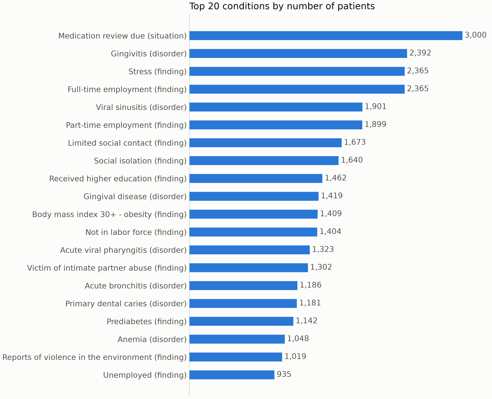
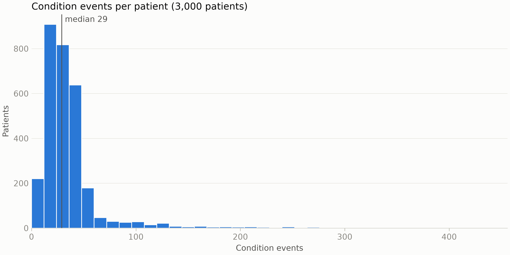
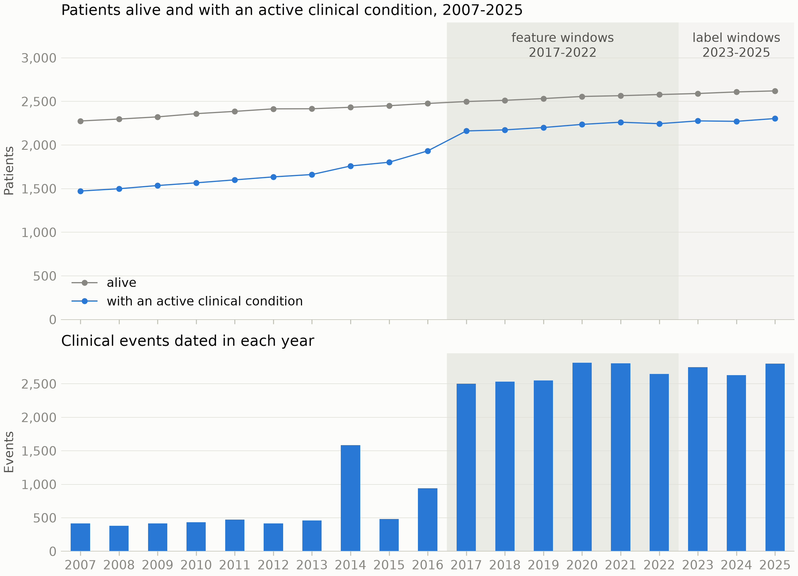
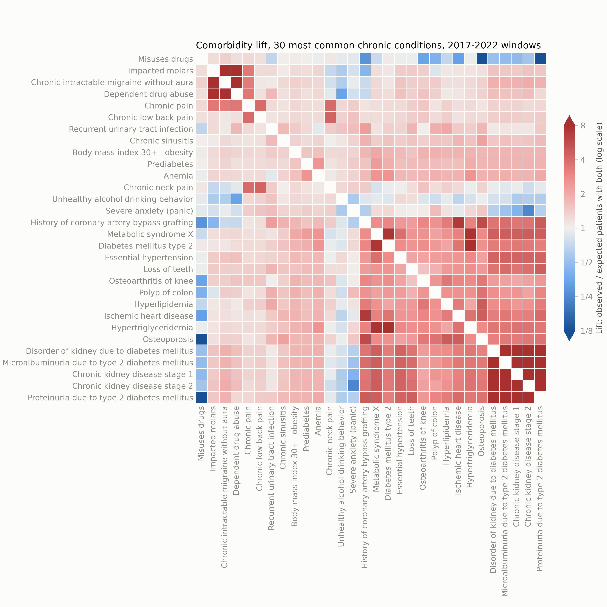
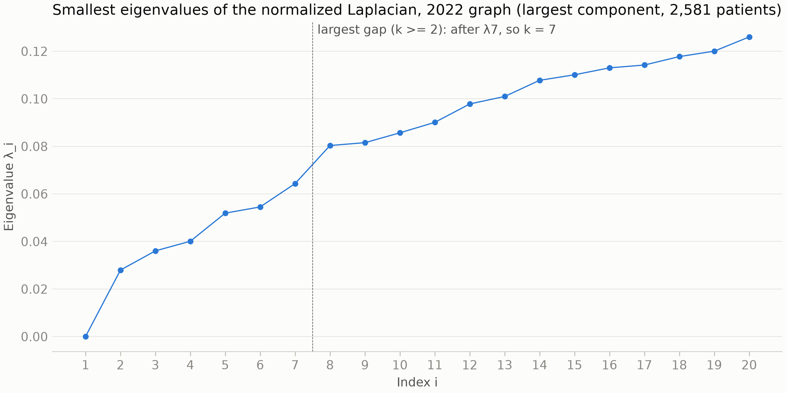
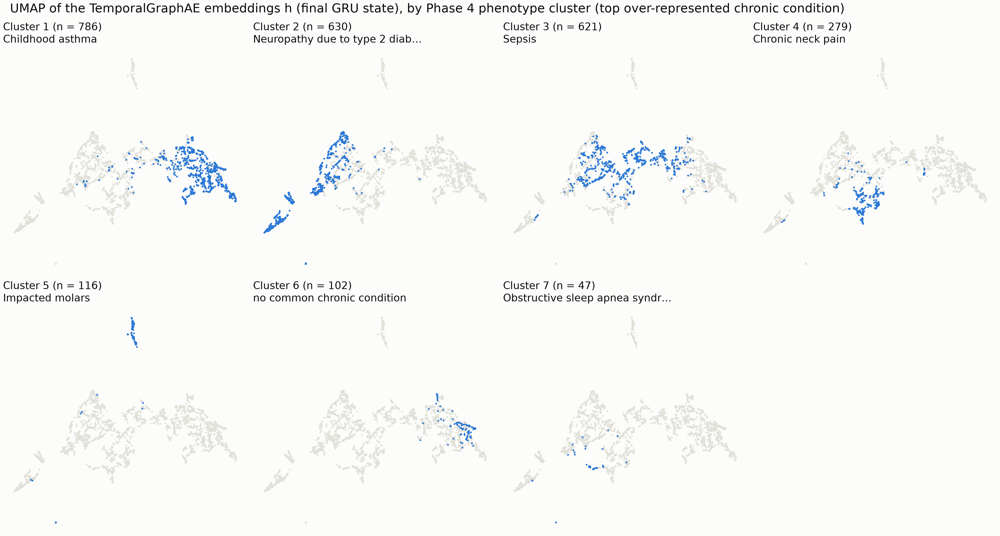
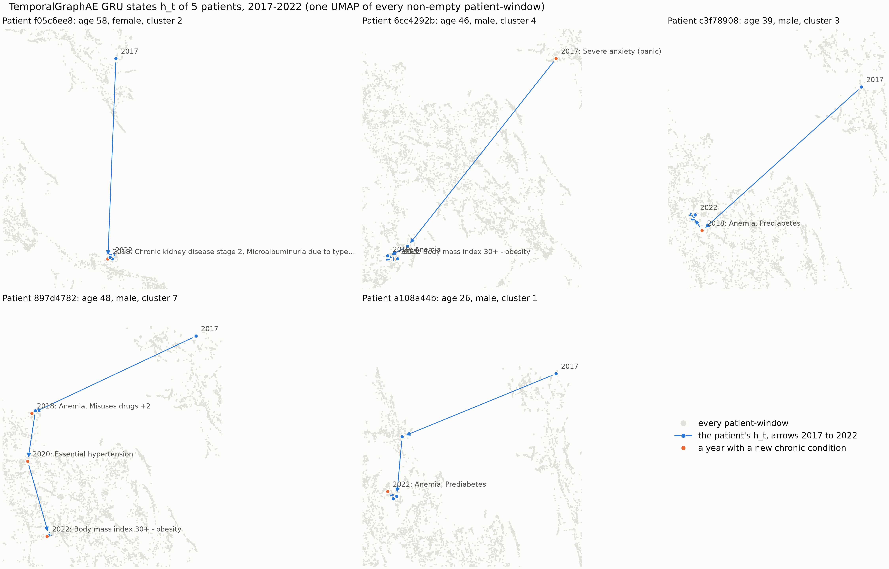
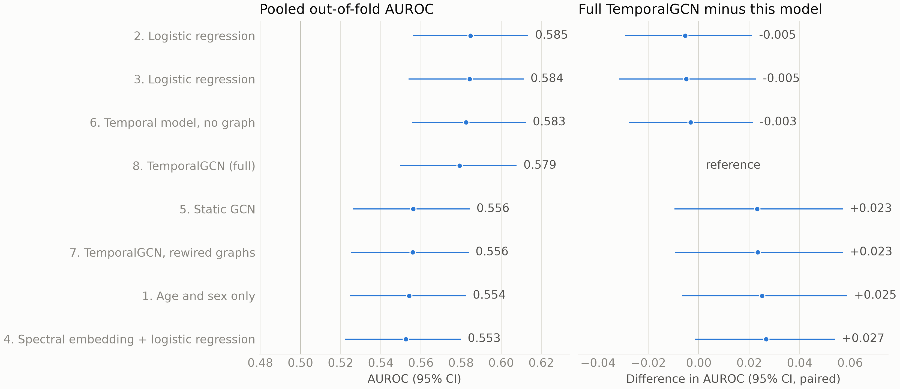

# Report figures

11 figures, numbered in report order (`final_figures` in `config/config.yaml`), saved at 300 dpi. They are the pipeline's own figures, copied by `scripts/10_final_figures.py`; the numbers in the captions are from `reports/findings.md`, `results.md` and `embedding_results.md`.

| Figure | File | Drawn by | Pixels |
| ---: | --- | --- | ---: |
| 1 | `01_data_top_conditions.png` | `../top_conditions_bar.png` | 2,700 x 2,190 |
| 2 | `02_data_events_per_patient.png` | `../events_per_patient_hist.png` | 2,700 x 1,350 |
| 3 | `03_active_patients_per_year.png` | `../active_patients_per_year.png` | 2,700 x 1,950 |
| 4 | `04_comorbidity_lift_heatmap.png` | `../comorbidity_lift_heatmap.png` | 3,300 x 3,300 |
| 5 | `05_laplacian_eigenvalues.png` | `../eigenvalues_final_window.png` | 2,700 x 1,350 |
| 6 | `06_graph_drift.png` | `../graph_drift.png` | 2,700 x 1,350 |
| 7 | `07_graphae_umap_phenotypes.png` | `../ae_umap_phenotype.png` | 4,080 x 2,190 |
| 8 | `08_graphae_trajectories.png` | `../ae_trajectories_umap.png` | 4,500 x 2,880 |
| 9 | `09_cv_auroc.png` | `../cv_auroc.png` | 3,300 x 1,428 |
| 10 | `10_next_year_auroc.png` | `../next_year_auroc.png` | 3,300 x 1,188 |
| 11 | `11_reliability_test.png` | `../reliability_test.png` | 1,920 x 1,800 |

**Figure 1.** The 20 most common condition codes in the raw Synthea export (3,000 patients), by number of patients. Social, administrative and situation codes (medication review, employment, stress, social isolation) are among the most common, which is why a clinical code filter (data.code_filter) keeps only disorders and a reviewed whitelist.

**Figure 2.** Condition events per patient in the raw export, every code, before the clinical filter (median 29, long right tail).

**Figure 3.** Top: patients alive and patients with an active clinical condition (active from onset to STOP or death) per year. Bottom: clinical events dated in each year. Events dated rise from about 400 a year to about 2,500 a year from 2017 (apart from a spike in 2014): Synthea exports a full record only for the 10 years before its run date, so earlier years hold mostly conditions that were still open. The windows therefore start in 2017. Shaded: feature windows 2017-2022 and label windows 2023-2025.

**Figure 4.** Comorbidity lift (observed over expected number of patients with both conditions active in the same window, log scale clipped to 1/8-8) between the 30 most common chronic conditions, 2017-2022. Rows and columns are ordered by average-linkage clustering of the lift profiles. Blocks: diabetic kidney disease (CKD stages 1-2, microalbuminuria, proteinuria), cardio-metabolic disease (metabolic syndrome, type 2 diabetes, hypertriglyceridaemia, ischaemic heart disease, bypass grafting), and chronic pain with migraine and drug abuse.

**Figure 5.** The 20 smallest eigenvalues of the normalized Laplacian L = I - A_hat of the 2022 k-NN patient-similarity graph (k = 10, 2,581 patients). The largest gap (k >= 2) follows the 7th eigenvalue, so the spectral clustering uses 7 phenotypes. The smooth rise (0.028 at i = 2 to 0.126 at i = 20) means the phenotypes partition a continuum rather than separate communities.

**Figure 6.** Neighbourhood overlap (Jaccard of the k-NN neighbour sets) between consecutive yearly graphs: mean over patients and interquartile range. The mean rises from 0.405 (2017 to 2018) to 0.604 (2021 to 2022), with no jump: neighbourhoods stabilise as histories accumulate.

**Figure 7.** UMAP of the self-supervised TemporalGraphAE trajectory embeddings (final GRU state, 32 dimensions), one panel per Phase 4 spectral phenotype (blue; grey: every other patient). Phenotypes 1, 2, 4 and 5 occupy distinct regions; 3 spreads across the middle and 7 (47 patients) is scattered. Silhouette against the phenotypes -0.012 (shuffled labels -0.181): better than chance, but the clusters touch.

**Figure 8.** The TemporalGraphAE state after each year 2017-2022 for 5 patients, on one UMAP of every non-empty patient-window; orange marks a year with a new chronic condition. The mean yearly step in the 32-dimensional space shrinks from 1.382 (2017 to 2018) to 0.267 (2021 to 2022): the long first steps are mostly the GRU state settling, and later moves coincide with new chronic onsets.

**Figure 9.** Left: pooled out-of-fold AUROC of any_onset (a new chronic onset in 2023-2025) for the 8 models of the 5-fold cross-validation (2,221 patients, 414 positives), with 95% percentile bootstrap intervals. Right: the paired difference from the full TemporalGCN. All models lie between 0.553 and 0.585, and no difference is shown.

**Figure 10.** New conditions in 2022 predicted from each 2021 embedding (one logistic regression per code, test patients). Left: micro AUROC over every patient-code pair; the dashed line is the codes' base rates alone (0.760). Right: macro AUROC, the mean over codes. The base rates explain the pooled AUROC; within a code the embeddings rank patients at 0.503-0.624.

**Figure 11.** Reliability of the final TemporalGCN's any_onset probabilities on the held-out test set (330 patients, 61 positives, 10 equal-count bins), before and after Platt scaling fitted on the validation split (a = 0.796, b = -1.272). Test AUROC 0.559 (0.483-0.632); Brier 0.155 against 0.151 for always predicting the base rate.
