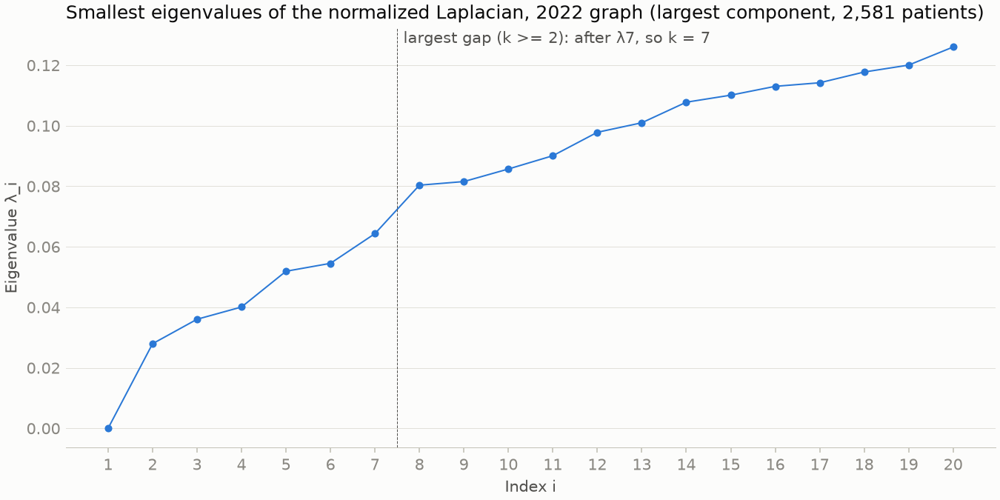
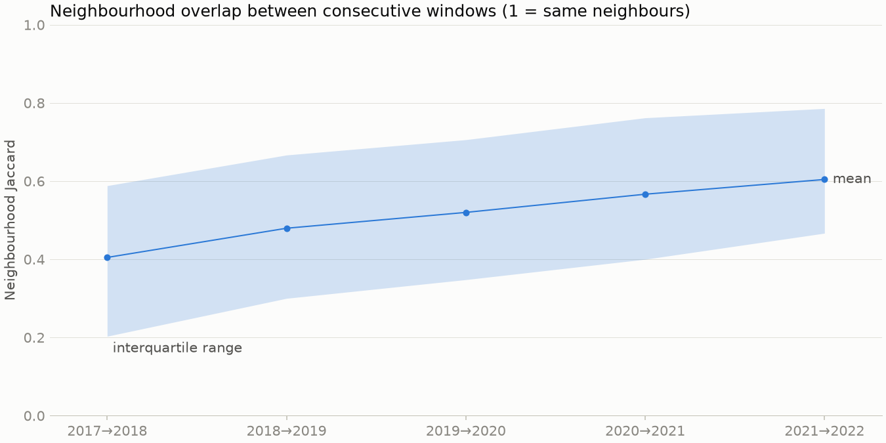

# Patient-similarity graphs

Built by `scripts/04_build_graphs.py` from `load_model_inputs`: the 2,581 model-cohort patients and the training-period windows 2017-2022 only; windows after the cutoff (2023-01-01) get no graph. W is the 10-NN graph of each window's feature rows, edge weight = cosine similarity, symmetrized with max(W, W^T), non-positive weights dropped. A patient whose row is all zero in a window is an isolated node there: left out of the neighbour search, with only the self-loop of A_hat = D^(-1/2) (W + I) D^(-1/2). L = I - D^(-1/2) W D^(-1/2).

## Graph statistics per window

| Year | Nodes with edges | Isolated | Edges | Mean degree | Mean weight | Components | Largest component | Clustering |
| ---: | ---: | ---: | ---: | ---: | ---: | ---: | ---: | ---: |
| 2017 | 2,160 | 421 | 16,255 | 15.1 | 0.703 | 3 | 2,128 | 0.466 |
| 2018 | 2,320 | 261 | 17,432 | 15.0 | 0.689 | 1 | 2,320 | 0.434 |
| 2019 | 2,427 | 154 | 18,272 | 15.1 | 0.678 | 1 | 2,427 | 0.405 |
| 2020 | 2,497 | 84 | 18,667 | 15.0 | 0.667 | 1 | 2,497 | 0.378 |
| 2021 | 2,547 | 34 | 18,950 | 14.9 | 0.660 | 1 | 2,547 | 0.366 |
| 2022 | 2,581 | 0 | 19,019 | 14.7 | 0.655 | 1 | 2,581 | 0.347 |

Mean degree is over nodes with an edge (k-NN symmetrized, so at least 10); components count those with an edge; clustering is the mean local clustering coefficient of nodes with degree >= 2, computed exactly.

## Spectrum of the final window (2022)

Normalized Laplacian of the largest connected component (2,581 of 2,581 patients); the first 20 eigenvalues, from eigsh.

| i | Eigenvalue | Gap to next |
| ---: | ---: | ---: |
| 1 | 0.0000 | 0.0280 |
| 2 | 0.0280 | 0.0081 |
| 3 | 0.0360 | 0.0040 |
| 4 | 0.0401 | 0.0118 |
| 5 | 0.0519 | 0.0026 |
| 6 | 0.0545 | 0.0098 |
| 7 | 0.0643 | 0.0160 |
| 8 | 0.0804 | 0.0012 |
| 9 | 0.0816 | 0.0041 |
| 10 | 0.0857 | 0.0044 |
| 11 | 0.0901 | 0.0077 |
| 12 | 0.0978 | 0.0031 |
| 13 | 0.1010 | 0.0068 |
| 14 | 0.1078 | 0.0023 |
| 15 | 0.1101 | 0.0029 |
| 16 | 0.1130 | 0.0012 |
| 17 | 0.1142 | 0.0035 |
| 18 | 0.1177 | 0.0023 |
| 19 | 0.1200 | 0.0060 |
| 20 | 0.1260 |  |

**Eigengap.** Among k >= 2, the largest gap is after λ7 (0.0643 to 0.0804, gap 0.0160), so the eigengap heuristic suggests 7 clusters. The next largest gap is after λ4 (0.0118); the largest is 1.4 times as large. The largest gap of all follows λ1 (0.0280), and the spectrum rises smoothly from λ2 = 0.0280 to λ20 = 0.1260: the graph is one continuum without sharply separated communities, and the 7 clusters are a partition of it rather than disconnected groups.

Spectral embedding: the 16 smallest non-trivial eigenvalues are 0.0280, 0.0360, 0.0401, 0.0519, 0.0545, 0.0643, 0.0804, 0.0816, 0.0857, 0.0901, 0.0978, 0.1010, 0.1078, 0.1101, 0.1130, 0.1142.

## Phenotypes (7 clusters)

Spectral clustering of the 2022 graph: k-means (10 restarts) on the first 7 eigenvectors, rows L2-normalized. Chronic conditions are those with a chronic episode (no STOP or longer than 365 days) active in 2017-2022.

| Cluster | Patients | With a chronic condition | Mean chronic conditions |
| ---: | ---: | ---: | ---: |
| 1 | 786 | 45% | 0.9 |
| 2 | 630 | 100% | 8.8 |
| 3 | 621 | 100% | 3.6 |
| 4 | 279 | 100% | 5.1 |
| 5 | 116 | 100% | 7.9 |
| 6 | 102 | 9% | 0.1 |
| 7 | 47 | 100% | 9.0 |

Top 5 over-represented chronic conditions per cluster: ratio = prevalence in the cluster / prevalence among all clustered patients, among conditions of at least 10 of the cluster's patients.

| Cluster | Rank | Condition | Patients | In cluster | Overall | Ratio |
| ---: | ---: | --- | ---: | ---: | ---: | ---: |
| 1 | 1 | Childhood asthma (disorder) | 46 | 6% | 2% | 3.1 |
| 1 | 2 | Perennial allergic rhinitis (disorder) | 40 | 5% | 2% | 3.1 |
| 1 | 3 | Seasonal allergic rhinitis (disorder) | 18 | 2% | 1% | 3.1 |
| 1 | 4 | Perennial allergic rhinitis with seasonal variation (disorder) | 50 | 6% | 2% | 3.0 |
| 1 | 5 | Child attention deficit disorder (disorder) | 25 | 3% | 1% | 3.0 |
| 2 | 1 | Neuropathy due to type 2 diabetes mellitus (disorder) | 37 | 6% | 1% | 4.0 |
| 2 | 2 | Nonproliferative diabetic retinopathy due to type II diabetes mellitus | 36 | 6% | 1% | 3.9 |
| 2 | 3 | Chronic kidney disease stage 4 (disorder) | 32 | 5% | 1% | 3.7 |
| 2 | 4 | Acute non-ST segment elevation myocardial infarction (disorder) | 52 | 8% | 2% | 3.7 |
| 2 | 5 | History of coronary artery bypass grafting (situation) | 125 | 20% | 5% | 3.7 |
| 3 | 1 | Sepsis (disorder) | 30 | 5% | 2% | 2.3 |
| 3 | 2 | Malignant neoplasm of breast (disorder) | 14 | 2% | 1% | 1.8 |
| 3 | 3 | Recurrent urinary tract infection (disorder) | 48 | 8% | 4% | 1.8 |
| 3 | 4 | Unhealthy alcohol drinking behavior (finding) | 99 | 16% | 9% | 1.8 |
| 3 | 5 | Localized  primary osteoarthritis of the hand (disorder) | 21 | 3% | 2% | 1.6 |
| 4 | 1 | Chronic neck pain (finding) | 162 | 58% | 11% | 5.3 |
| 4 | 2 | Chronic low back pain (finding) | 234 | 84% | 18% | 4.7 |
| 4 | 3 | Fibromyalgia (disorder) | 25 | 9% | 2% | 4.0 |
| 4 | 4 | Chronic pain (finding) | 274 | 98% | 25% | 3.9 |
| 4 | 5 | Unhealthy alcohol drinking behavior (finding) | 40 | 14% | 9% | 1.6 |
| 5 | 1 | Impacted molars (disorder) | 106 | 91% | 5% | 18.4 |
| 5 | 2 | Dependent drug abuse (disorder) | 105 | 91% | 5% | 18.0 |
| 5 | 3 | Chronic intractable migraine without aura (disorder) | 101 | 87% | 5% | 17.7 |
| 5 | 4 | Chronic pain (finding) | 104 | 90% | 25% | 3.6 |
| 5 | 5 | Sleep disorder (disorder) | 13 | 11% | 4% | 3.0 |
| 6 | - | (no chronic condition in 10 or more of its patients) |  |  |  |  |
| 7 | 1 | Obstructive sleep apnea syndrome (disorder) | 46 | 98% | 2% | 40.7 |
| 7 | 2 | Sleep disorder (disorder) | 47 | 100% | 4% | 26.3 |
| 7 | 3 | Essential hypertension (disorder) | 29 | 62% | 21% | 2.9 |
| 7 | 4 | Metabolic syndrome X (disorder) | 18 | 38% | 13% | 2.9 |
| 7 | 5 | Ischemic heart disease (disorder) | 14 | 30% | 14% | 2.2 |

## Graph drift

Neighbourhood Jaccard between consecutive windows, for patients with neighbours in both: |N_t(i) & N_t+1(i)| / |N_t(i) | N_t+1(i)|. Unchanged: Jaccard 1; replaced: 0.

| Windows | Patients | Mean | Median | IQR | Unchanged | Replaced | Jump |
| --- | ---: | ---: | ---: | ---: | ---: | ---: | --- |
| 2017→2018 | 2,160 | 0.405 | 0.409 | 0.203-0.588 | 0.3% | 3.5% | no |
| 2018→2019 | 2,320 | 0.479 | 0.500 | 0.300-0.667 | 1.1% | 2.9% | no |
| 2019→2020 | 2,427 | 0.520 | 0.552 | 0.348-0.706 | 1.2% | 2.4% | no |
| 2020→2021 | 2,497 | 0.567 | 0.615 | 0.400-0.762 | 2.2% | 1.8% | no |
| 2021→2022 | 2,547 | 0.604 | 0.652 | 0.467-0.786 | 2.2% | 1.7% | no |

No jump: no pair's mean Jaccard is both below its adjacent pairs and more than 0.1 below the straight line through them. The mean rises every year, from 0.405 (2017→2018) to 0.604 (2021→2022).
