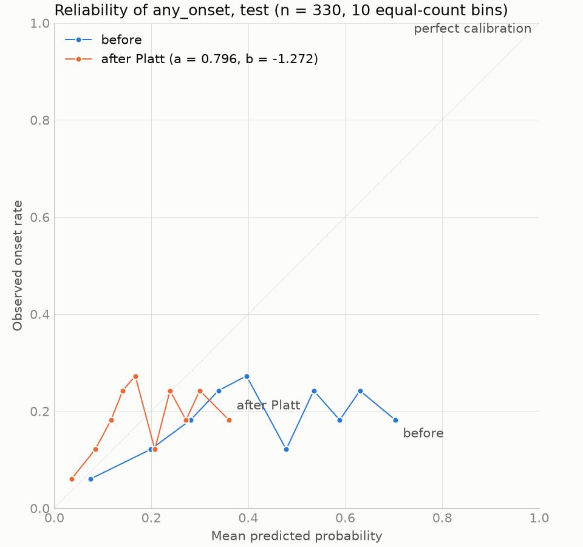
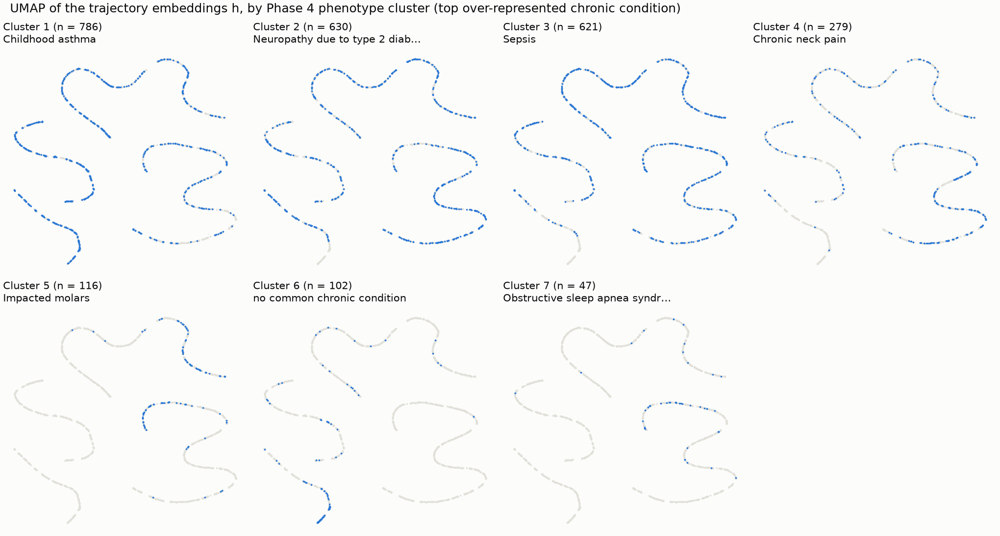
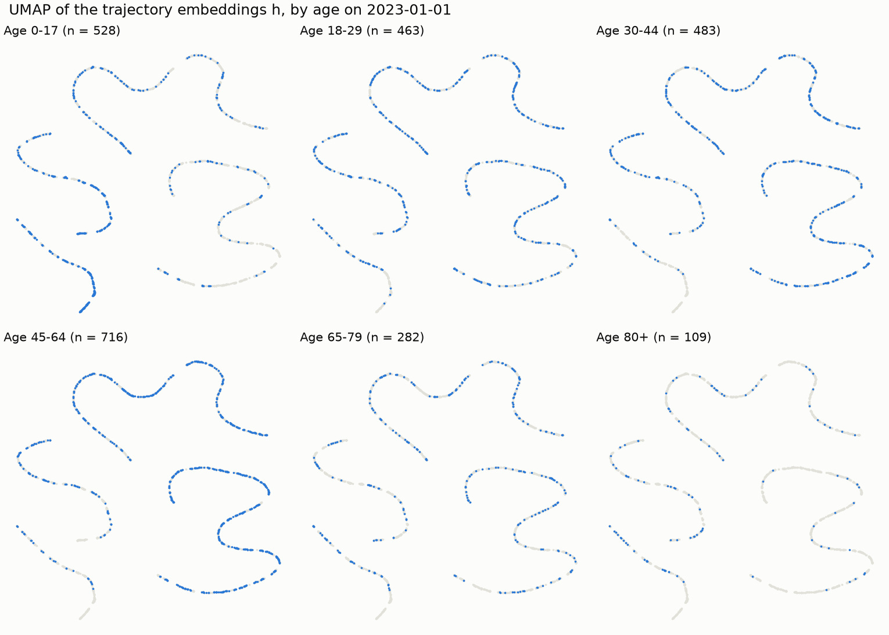
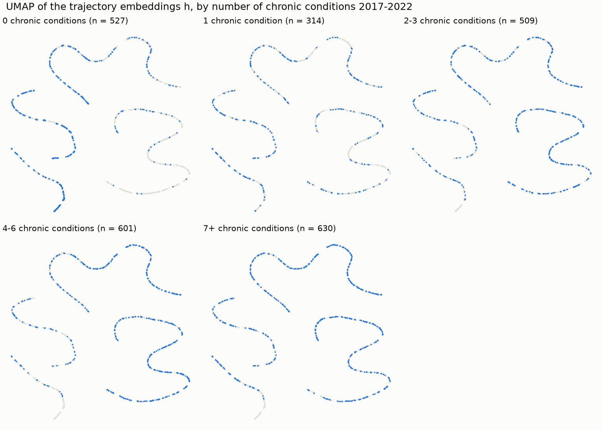
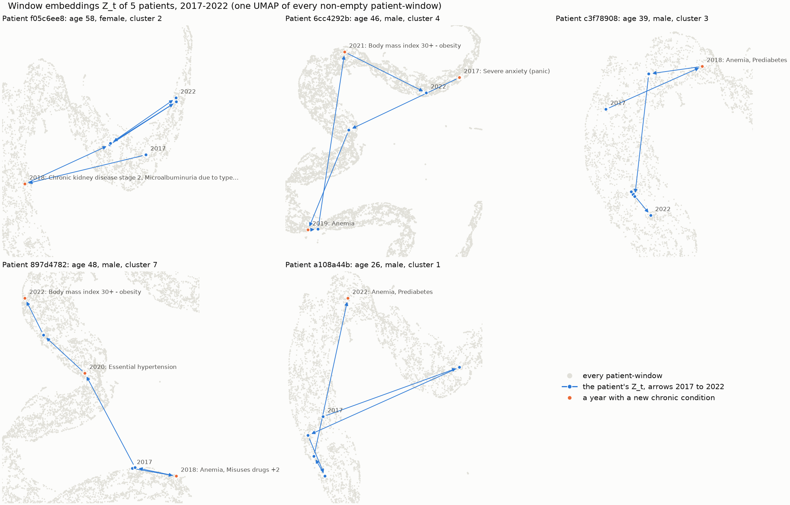

# Results

Built by `scripts/07_evaluate.py`. Primary target `any_onset`: a new onset in any of the 9 onset groups from 2023-01-01 to the end of 2025 (see `labels_summary.md`). Every model reads only the windows 2017-2022, before the cutoff. Every GCN keeps the hyperparameters tuned in Phase 6b (hidden/embedding 64/32, dropout 0.6, weight decay 0.005, lr 0.01, smoothness loss 0, DropEdge 0) and has age and sex in its heads; nothing here was tuned. Plain-language findings: `evaluation_summary.md`.

## Main comparison: 5-fold cross-validation

- **Patients:** all 2,221 patients with an observed `any_onset` (414 positives, 18.6%), in 5 folds stratified by phenotype cluster x `any_onset` (seed 42); held-out folds of 444-445 patients.
- **Within each fold:** 15% of the training folds, stratified the same way, form an inner validation set (265 patients). It picks each GCN's epoch (early stopping on its AUROC) and fits every model's Platt scaling. Every model is fitted on the other 85% (1,511-1,512 patients). The held-out fold is scored once.
- **GCN models (5-8)** are trained with seeds 42, 43, 44 in every fold and their logits averaged before calibration. Training is transductive, as in Phase 6: all 2,581 patients are graph nodes with their pre-cutoff features in every fold; only the inner training labels enter a loss. Model 7's graphs are each window's graph rewired by 10 degree-preserving double edge swaps per edge (seed 42): every patient keeps their number of neighbours, but who is linked to whom is random.
- **Logistic regressions (1-4):** L2 penalty, C = 1.0, class weights balanced, as in `baselines_summary.md`. Model 4's eigenvectors are standardized with the inner training patients' mean and sd.
- **Out-of-fold (OOF) predictions:** each patient's Platt-calibrated probability from the fold that held them out. Pooled metrics use all of them together; per-fold metrics average the folds.
- **Optimism:** the GCN hyperparameters were chosen on the original validation split (Phase 6b), whose labelled patients are part of these folds, so the cross-validated GCN estimates (models 5-8) are slightly optimistic. The logistic regressions were not tuned.

| Rank | # | Model | Inputs | Fold AUROC, mean +/- sd | Fold AUPRC, mean +/- sd | Pooled OOF AUROC (95% CI) | Pooled OOF AUPRC (95% CI) | Full TemporalGCN minus this, AUROC (95% CI) | Folds full better | Brier |
| ---: | ---: | --- | --- | ---: | ---: | ---: | ---: | ---: | ---: | ---: |
| 1 | 2 | Logistic regression | 2022 window + age, sex | 0.587 +/- 0.022 | 0.236 +/- 0.015 | 0.585 (0.556 to 0.614) | 0.228 (0.202 to 0.261) | -0.005 (-0.029 to +0.021) | 2 / 5 | 0.150 |
| 2 | 3 | Logistic regression | 6 windows 2017-2022, concatenated + age, sex | 0.585 +/- 0.029 | 0.242 +/- 0.017 | 0.584 (0.554 to 0.611) | 0.228 (0.200 to 0.258) | -0.005 (-0.032 to +0.023) | 2 / 5 | 0.150 |
| 3 | 6 | Temporal model, no graph | 6 windows 2017-2022, A_hat = I in every window; age, sex in the heads | 0.582 +/- 0.019 | 0.232 +/- 0.009 | 0.583 (0.556 to 0.612) | 0.226 (0.199 to 0.257) | -0.003 (-0.028 to +0.021) | 4 / 5 | 0.151 |
| 4 | 8 | **TemporalGCN (full)** | 6 windows 2017-2022 + similarity graphs; age, sex in the heads | 0.584 +/- 0.031 | 0.234 +/- 0.019 | 0.579 (0.549 to 0.608) | 0.221 (0.194 to 0.250) | reference |  | 0.150 |
| 5 | 5 | Static GCN | 2022 window and its graph; age, sex in the heads | 0.561 +/- 0.014 | 0.200 +/- 0.006 | 0.556 (0.526 to 0.584) | 0.196 (0.175 to 0.221) | +0.023 (-0.010 to +0.057) | 3 / 5 | 0.151 |
| 6 | 7 | TemporalGCN, rewired graphs | 6 windows 2017-2022 + degree-preserving random graphs; age, sex in the heads | 0.561 +/- 0.014 | 0.200 +/- 0.006 | 0.556 (0.525 to 0.584) | 0.196 (0.175 to 0.220) | +0.023 (-0.009 to +0.057) | 3 / 5 | 0.151 |
| 7 | 1 | Age and sex only | age at the cutoff and sex, logistic regression | 0.563 +/- 0.008 | 0.203 +/- 0.007 | 0.554 (0.525 to 0.582) | 0.198 (0.177 to 0.222) | +0.025 (-0.007 to +0.059) | 3 / 5 | 0.151 |
| 8 | 4 | Spectral embedding + logistic regression | 16 Laplacian eigenvectors of the 2022 graph + age, sex | 0.554 +/- 0.037 | 0.206 +/- 0.017 | 0.553 (0.522 to 0.580) | 0.199 (0.178 to 0.224) | +0.027 (-0.002 to +0.054) | 4 / 5 | 0.151 |

Sorted by pooled OOF AUROC. Fold columns: mean and sd (ddof 1) over the 5 held-out folds. Pooled columns: percentile bootstrap over the 2,221 patients, 1,000 resamples shared by every model, so the differences are paired. These intervals reflect which patients were sampled, not the variation from retraining the models. AUPRC of a random score: 0.186. Brier: of the calibrated OOF probabilities; always predicting the observed rate scores 0.152. Also in `results.csv` (with ECE).

## Ablations

Each row compares the full TemporalGCN (model 8) with one other model on the same 2,221 patients (paired bootstrap of the pooled OOF AUROC).

| Question | Comparison | Full AUROC | Other AUROC | Full minus other (95% CI) | Folds full better | Reading |
| --- | --- | ---: | ---: | ---: | ---: | --- |
| Does the graph help? | 8 vs 6: Temporal model, no graph (6 windows 2017-2022, A_hat = I in every window; age, sex in the heads) | 0.579 | 0.583 | -0.003 (-0.028 to +0.021) | 4 / 5 | not shown (CI includes 0) |
| Does time help? | 8 vs 5: Static GCN (2022 window and its graph; age, sex in the heads) | 0.579 | 0.556 | +0.023 (-0.010 to +0.057) | 3 / 5 | not shown (CI includes 0) |
| Does the real similarity structure matter? | 8 vs 7: TemporalGCN, rewired graphs (6 windows 2017-2022 + degree-preserving random graphs; age, sex in the heads) | 0.579 | 0.556 | +0.023 (-0.009 to +0.057) | 3 / 5 | not shown (CI includes 0) |
| Is it better than the best non-GCN model? | 8 vs 2: Logistic regression (2022 window + age, sex) | 0.579 | 0.585 | -0.005 (-0.029 to +0.021) | 2 / 5 | not shown (CI includes 0) |
| Is it better than age and sex alone? | 8 vs 1: Age and sex only (age at the cutoff and sex, logistic regression) | 0.579 | 0.554 | +0.025 (-0.007 to +0.059) | 3 / 5 | not shown (CI includes 0) |

Model 5 still sees the past in aggregate: its 2022 window's TF-IDF block is a time-decayed sum of every earlier window and its transition block holds every transition before the cutoff. "Time" here is the sequence of windows and the GRU over them.

**Models that reduce to age and sex.** Model 5 (Static GCN) and Model 7 (TemporalGCN, rewired graphs) rank the held-out patients almost exactly as age and sex alone do (mean within-fold Spearman correlation with model 1 of at least 0.9; see Fits): with the hyperparameters fixed at the full model's tuned setting, they learned little beyond the demographics in their heads. A comparison with such a model says how much the full model adds to age and sex, not how much time or the real graph adds to a working static or random-graph model.

## Per-fold AUROC

| Fold | Patients (positives) | 1 | 2 | 3 | 4 | 5 | 6 | 7 | 8 |
| ---: | ---: | ---: | ---: | ---: | ---: | ---: | ---: | ---: | ---: |
| 1 | 445 (82) | 0.558 | 0.573 | 0.543 | 0.588 | 0.559 | 0.572 | 0.560 | 0.542 |
| 2 | 444 (81) | 0.575 | 0.615 | 0.601 | 0.561 | 0.578 | 0.600 | 0.578 | 0.621 |
| 3 | 444 (83) | 0.559 | 0.605 | 0.615 | 0.573 | 0.562 | 0.600 | 0.561 | 0.603 |
| 4 | 444 (84) | 0.569 | 0.576 | 0.598 | 0.557 | 0.567 | 0.557 | 0.568 | 0.566 |
| 5 | 444 (84) | 0.556 | 0.563 | 0.568 | 0.492 | 0.539 | 0.581 | 0.539 | 0.589 |

Columns are the model numbers of the main table.

## Fits

| Model | Best epoch, mean (range) | Inner validation AUROC, mean | Platt slope, range over folds | Rank correlation with model 1, mean (range over folds) |
| --- | ---: | ---: | ---: | ---: |
| 1. Age and sex only |  | 0.563 | 0.40 to 1.67 | 1 (itself) |
| 2. Logistic regression |  | 0.608 | 0.50 to 0.94 | 0.37 (0.31 to 0.41) |
| 3. Logistic regression |  | 0.585 | 0.23 to 0.41 | 0.31 (0.23 to 0.35) |
| 4. Spectral embedding + logistic regression |  | 0.578 | 0.55 to 1.27 | 0.54 (0.37 to 0.64) |
| 5. Static GCN | 23 (1-50) | 0.579 | 0.72 to 2.57 | 0.97 (0.93 to 1.00) |
| 6. Temporal model, no graph | 23 (6-59) | 0.622 | 0.22 to 2.49 | 0.32 (0.05 to 0.77) |
| 7. TemporalGCN, rewired graphs | 25 (1-65) | 0.578 | 0.72 to 2.60 | 0.97 (0.93 to 0.99) |
| 8. TemporalGCN (full) | 30 (7-94) | 0.607 | 0.49 to 1.25 | 0.46 (0.26 to 0.58) |

GCN rows: one fit per fold and seed (5 x 3 per model); their inner validation AUROC is each seed's at its best epoch. Logistic rows: one fit per fold. The Platt slope is fitted per fold on the inner validation logits. Rank correlation: Spearman correlation between the model's and model 1's (age and sex only) out-of-fold logits, within each held-out fold.

## Onset groups (secondary targets, pooled OOF AUROC)

Pooled out-of-fold AUROC of each group's score with its 95% CI, on the patients with that group's label observed. Group scores are uncalibrated (too few inner validation positives per group to fit Platt scaling), so pooling mixes the folds' scales; the logistic regressions fit one model per group.

| Group | Positives / observed | 1 | 2 | 3 | 4 | 5 | 6 | 7 | 8 |
| --- | ---: | ---: | ---: | ---: | ---: | ---: | ---: | ---: | ---: |
| ckd * | 32 / 2,054 | 0.75 (0.69-0.81) | 0.86 (0.80-0.91) | 0.79 (0.70-0.86) | 0.81 (0.75-0.87) | 0.75 (0.69-0.81) | 0.61 (0.52-0.71) | 0.75 (0.69-0.81) | 0.72 (0.63-0.80) |
| prediabetes | 51 / 1,381 | 0.53 (0.47-0.59) | 0.56 (0.48-0.63) | 0.55 (0.47-0.63) | 0.60 (0.54-0.66) | 0.55 (0.49-0.61) | 0.60 (0.52-0.68) | 0.55 (0.48-0.61) | 0.63 (0.54-0.70) |
| hypertension | 51 / 1,729 | 0.68 (0.62-0.74) | 0.65 (0.59-0.71) | 0.56 (0.48-0.63) | 0.55 (0.48-0.63) | 0.70 (0.64-0.76) | 0.59 (0.52-0.67) | 0.70 (0.64-0.76) | 0.64 (0.56-0.71) |
| ischemic_heart_disease | 55 / 1,887 | 0.88 (0.85-0.91) | 0.86 (0.82-0.89) | 0.81 (0.78-0.85) | 0.86 (0.82-0.89) | 0.85 (0.82-0.88) | 0.66 (0.59-0.73) | 0.85 (0.82-0.88) | 0.78 (0.73-0.82) |
| metabolic_syndrome * | 31 / 1,924 | 0.71 (0.65-0.77) | 0.70 (0.64-0.76) | 0.67 (0.59-0.74) | 0.68 (0.61-0.75) | 0.72 (0.65-0.78) | 0.70 (0.64-0.76) | 0.72 (0.66-0.78) | 0.64 (0.56-0.73) |
| hyperlipidemia | 56 / 1,915 | 0.76 (0.71-0.81) | 0.72 (0.66-0.78) | 0.71 (0.65-0.77) | 0.70 (0.64-0.76) | 0.76 (0.71-0.81) | 0.66 (0.59-0.72) | 0.76 (0.71-0.81) | 0.68 (0.62-0.74) |
| obesity | 72 / 1,188 | 0.71 (0.67-0.74) | 0.67 (0.62-0.73) | 0.69 (0.63-0.75) | 0.66 (0.60-0.72) | 0.70 (0.66-0.74) | 0.64 (0.57-0.70) | 0.70 (0.65-0.74) | 0.66 (0.61-0.71) |
| chronic_pain * | 34 / 1,608 | 0.73 (0.68-0.78) | 0.80 (0.73-0.86) | 0.77 (0.70-0.84) | 0.80 (0.73-0.85) | 0.75 (0.69-0.81) | 0.61 (0.51-0.70) | 0.75 (0.69-0.81) | 0.71 (0.63-0.79) |
| substance_use | 109 / 1,720 | 0.61 (0.56-0.66) | 0.59 (0.53-0.64) | 0.55 (0.49-0.61) | 0.60 (0.54-0.65) | 0.61 (0.56-0.66) | 0.55 (0.49-0.60) | 0.61 (0.56-0.66) | 0.60 (0.55-0.65) |

\* borderline or near the review threshold of 30 onsets (see `labels_summary.md`).

## Held-out test set (single shot)

The final model of `06_train.py` (trained on the training split, epoch chosen on the validation split, Platt scaling a = 0.796, b = -1.272 fitted on it; `calibration.json`), scored once on the 330 test patients with an observed `any_onset` (61 positives, 18.5%). No choice was made with test labels. Percentile bootstrap over the test patients, 1,000 resamples. The F1 threshold maximizes F1 on the validation patients' calibrated probabilities.

| Metric | Test, Platt-calibrated (95% CI) | Test, uncalibrated | Reference |
| --- | ---: | ---: | --- |
| AUROC | 0.559 (0.483 to 0.632) | 0.559 | 0.500 (chance) |
| AUPRC | 0.218 (0.164 to 0.310) | 0.218 | 0.185 (a random score) |
| Brier score | 0.155 (0.129 to 0.180) | 0.231 | 0.151 (always the observed rate) |
| ECE | 0.075 (0.059 to 0.130) | 0.238 | 0 (perfect) |
| Mean predicted probability | 0.192 | 0.422 | 0.185 (observed rate) |
| F1 at threshold 0.206 | 0.291 (0.206 to 0.370) |  | 0.312 (predict an onset for everyone) |
| Precision at that threshold | 0.204 (0.139 to 0.268) |  |  |
| Recall at that threshold | 0.508 (0.383 to 0.627) |  |  |

The same model's validation AUROC was 0.678; the validation split chose its hyperparameters and its epoch, so that number is optimistic.

### Out-of-fold AUROC by original split

The cross-validation's out-of-fold AUROC on the patients of each Phase 5 split (columns: model numbers). The patients are the same as in the single-split numbers; only the training patients and seeds differ.

| Phase 5 split | Patients (positives) | 1 | 2 | 3 | 4 | 5 | 6 | 7 | 8 |
| --- | ---: | ---: | ---: | ---: | ---: | ---: | ---: | ---: | ---: |
| train | 1,556 (290) | 0.541 | 0.579 | 0.582 | 0.553 | 0.541 | 0.580 | 0.540 | 0.555 |
| val | 335 (63) | 0.562 | 0.585 | 0.602 | 0.542 | 0.567 | 0.601 | 0.569 | 0.633 |
| test | 330 (61) | 0.610 | 0.609 | 0.574 | 0.554 | 0.621 | 0.578 | 0.621 | 0.640 |

On the 330 test patients, the full model scores 0.559 when trained once on the training split and 0.640 out of fold; on the validation patients, 0.678 and 0.633. The same patients are ranked quite differently by models trained on other patients and seeds, so a single split's AUROC is a noisy estimate; the pooled cross-validated AUROC (0.579) uses every labelled patient.

Onset groups on the test set (secondary head, uncalibrated scores):

| Group | Test positives / observed | AUROC (95% CI) |
| --- | ---: | ---: |
| ckd * | 6 / 303 | 0.724 (0.579 to 0.862) |
| prediabetes | 11 / 208 | 0.672 (0.511 to 0.823) |
| hypertension | 5 / 247 | 0.669 (0.487 to 0.842) |
| ischemic_heart_disease | 9 / 283 | 0.798 (0.686 to 0.894) |
| metabolic_syndrome * | 5 / 281 | 0.482 (0.331 to 0.684) |
| hyperlipidemia | 11 / 291 | 0.849 (0.758 to 0.926) |
| obesity | 9 / 171 | 0.632 (0.449 to 0.803) |
| chronic_pain * | 4 / 231 | 0.824 (0.738 to 0.904) |
| substance_use | 17 / 248 | 0.542 (0.400 to 0.681) |

With 4-17 test positives per group, these AUROCs are noisy.

## Embedding analysis (final model)

Embeddings of the final model: the trajectory embedding h (the GRU's final state, 32 numbers per patient) and the window embeddings Z_t (the GCN's output per window). Neither includes age or sex, which enter only the prediction heads.

### UMAP of the trajectory embeddings

UMAP (n_neighbors 15, min_dist 0.1, seed 42) of h for all 2,581 patients. Each panel highlights one group in blue over everyone else in gray.

### Cluster separation

Silhouette score (-1 to 1, higher = clusters better separated) and Davies-Bouldin index (>= 0, lower = better) of each representation against the 7 Phase 4 phenotype clusters, Euclidean. The clusters were defined by k-means on the first Laplacian eigenvectors of the 2022 graph (rows normalized), so the spectral row is their reference; it stays low because the graph is one continuum (see `graphs_summary.md`).

| Representation | Dimensions | Silhouette | Davies-Bouldin |
| --- | ---: | ---: | ---: |
| Trajectory embedding h | 32 | -0.335 | 10.54 |
| Window embedding Z_2022 | 32 | -0.349 | 5.65 |
| Spectral embedding of the 2022 graph | 16 | 0.047 | 2.04 |
| 2022 window features (model input) | 236 | 0.041 | 3.99 |
| Trajectory embedding h, clusters shuffled (chance) | 32 | -0.127 | 91.52 |

**Spread of h.** Its first three principal components hold 99.8%, 0.2%, 0.0% of its variance, and the median distance between a patient and a random other patient is 0.8157 (the nearest-neighbour distances below are on this scale).

### Trajectories

Z_t and h live in different spaces (GCN output vs GRU state), so the trajectories are drawn in their own UMAP, fitted on the 14,533 non-empty patient-windows' Z_t (the 953 patient-windows with an empty feature row share one constant embedding and are left out). Patients drawn with seed 42, one per phenotype, among those with a non-empty feature row in every window and at least 2 chronic-condition onsets in 2017-2022.

| Patient | Age, sex | Cluster | Year | New chronic conditions |
| --- | --- | ---: | ---: | --- |
| f05c6ee8 | age 58, female | 2 | 2018 | Chronic kidney disease stage 2, Microalbuminuria due to type 2 diabetes mellitus |
| 6cc4292b | age 46, male | 4 | 2017 | Severe anxiety (panic) |
| 6cc4292b | age 46, male | 4 | 2019 | Anemia |
| 6cc4292b | age 46, male | 4 | 2021 | Body mass index 30+ - obesity |
| c3f78908 | age 39, male | 3 | 2018 | Anemia, Prediabetes |
| 897d4782 | age 48, male | 7 | 2018 | Anemia, Misuses drugs, Sleep disorder, Obstructive sleep apnea syndrome |
| 897d4782 | age 48, male | 7 | 2020 | Essential hypertension |
| 897d4782 | age 48, male | 7 | 2022 | Body mass index 30+ - obesity |
| a108a44b | age 26, male | 1 | 2022 | Anemia, Prediabetes |

### Nearest neighbours

For every patient with a chronic condition: the mean Jaccard index of their chronic conditions (2017-2022) with each of their 5 nearest neighbours, and the share of those neighbours in their phenotype cluster.

| Representation | Metric | Patients | Jaccard with 5 neighbours | Same phenotype |
| --- | --- | ---: | ---: | ---: |
| Trajectory embedding h | euclidean | 2,054 | 0.131 | 28.2% |
| Window embedding Z_2022 | euclidean | 2,054 | 0.188 | 42.3% |
| 2022 window features (the graph's neighbours) | cosine | 2,054 | 0.507 | 83.6% |
| Spectral embedding of the 2022 graph | euclidean | 2,054 | 0.382 | 89.3% |
| Random other patients (chance) | - | 2,054 | 0.096 | 21.8% |

**Patient b79bfd11** (age 29, female, cluster 3); 3 chronic conditions: Anemia, Prediabetes, Severe anxiety (panic).

| Rank | Neighbour | Distance | Age, sex | Cluster | Chronic conditions | Shared with the patient | Jaccard |
| ---: | --- | ---: | --- | ---: | ---: | --- | ---: |
| 1 | b66abfa2 | 0.002 | age 75, female | 2 | 16 | Anemia, Prediabetes | 0.12 |
| 2 | 201f060e | 0.003 | age 4, female | 1 | 0 | none | 0.00 |
| 3 | 78358a72 | 0.004 | age 37, male | 3 | 4 | Anemia, Prediabetes | 0.40 |
| 4 | c3640efe | 0.004 | age 54, male | 2 | 3 | Anemia, Prediabetes | 0.50 |
| 5 | 3459916b | 0.004 | age 60, male | 3 | 3 | Anemia, Prediabetes | 0.50 |

**Patient a7a55ab9** (age 59, male, cluster 2); 5 chronic conditions: Anemia, Body mass index 30+ - obesity, Loss of teeth, Misuses drugs, Prediabetes.

| Rank | Neighbour | Distance | Age, sex | Cluster | Chronic conditions | Shared with the patient | Jaccard |
| ---: | --- | ---: | --- | ---: | ---: | --- | ---: |
| 1 | 69423695 | 0.003 | age 61, female | 4 | 4 | Body mass index 30+ - obesity | 0.12 |
| 2 | 3892c02c | 0.007 | age 47, male | 1 | 1 | none | 0.00 |
| 3 | c2839950 | 0.007 | age 26, female | 3 | 1 | Prediabetes | 0.20 |
| 4 | 6519f5f5 | 0.007 | age 49, female | 4 | 4 | Body mass index 30+ - obesity | 0.12 |
| 5 | e0d345d8 | 0.008 | age 46, male | 3 | 4 | Body mass index 30+ - obesity | 0.12 |

**Patient 3ba2b0ae** (age 54, female, cluster 4); 8 chronic conditions: Anemia, Body mass index 30+ - obesity, Chronic low back pain, Chronic neck pain, Chronic pain, Essential hypertension, Localized  primary osteoarthritis of the hand, Prediabetes.

| Rank | Neighbour | Distance | Age, sex | Cluster | Chronic conditions | Shared with the patient | Jaccard |
| ---: | --- | ---: | --- | ---: | ---: | --- | ---: |
| 1 | a2dfc750 | 0.003 | age 38, male | 2 | 3 | Anemia, Body mass index 30+ - obesity, Prediabetes | 0.38 |
| 2 | deaa84ff | 0.003 | age 41, female | 5 | 8 | Body mass index 30+ - obesity, Chronic pain | 0.14 |
| 3 | 20746fef | 0.003 | age 45, female | 1 | 3 | Body mass index 30+ - obesity, Prediabetes | 0.22 |
| 4 | 3a70df71 | 0.003 | age 45, male | 5 | 7 | Body mass index 30+ - obesity, Chronic pain | 0.15 |
| 5 | 5ef7366d | 0.003 | age 53, female | 3 | 6 | Body mass index 30+ - obesity, Chronic neck pain, Chronic pain, Prediabetes | 0.40 |

## Outputs

- `results.csv`: the main table, one row per model.
- `artifacts/cv_oof_predictions.csv`: every patient's out-of-fold predictions; `artifacts/cv_fits.csv`: one row per fit (fold, model, seed); `artifacts/test_predictions.csv`: the final model's test predictions.
- Figures in `figures/`: `cv_auroc.png`, `reliability_test.png`, `umap_phenotype.png`, `umap_age_group.png`, `umap_chronic_conditions.png`, `trajectories_umap.png`.
