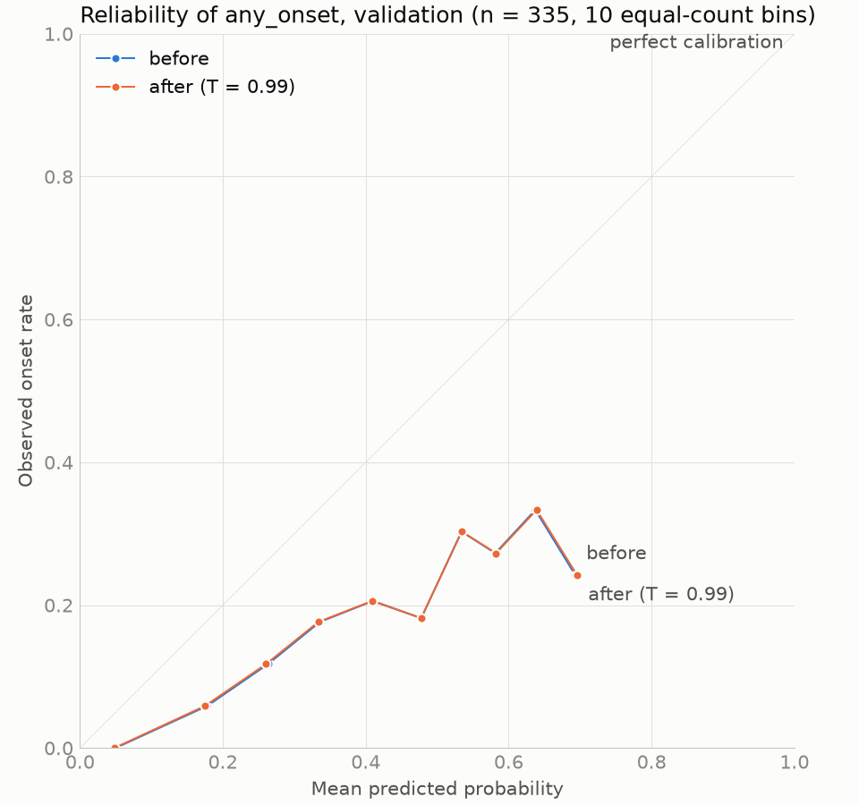
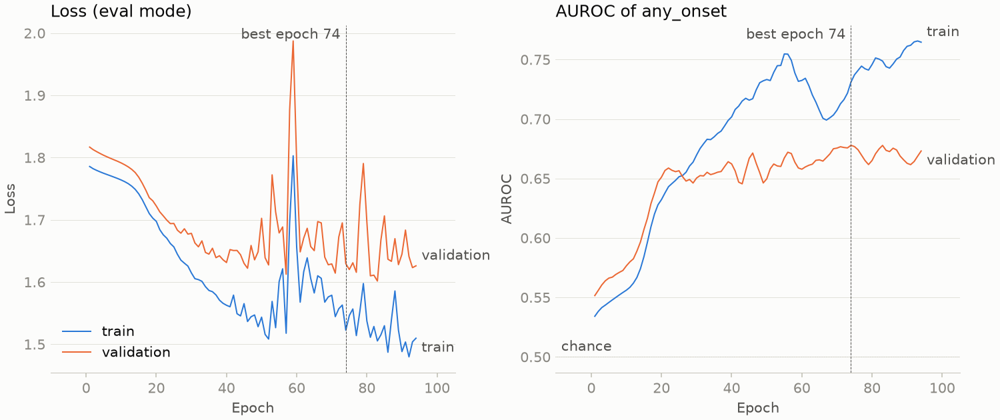

# Training

Built by `scripts/06_train.py`. All 2,581 model-cohort patients.

## Setup

- **Inputs:** windows 2017-2022 (all before the cutoff 2023-01-01), 236 features per window, and each window's Phase 4 graph `A_hat = D^(-1/2) (W + I) D^(-1/2)`; isolated nodes keep only their self-loop.
- **Transductive training:** every patient is a node and passes messages with its pre-cutoff features: train, validation and test patients, and those whose labels are masked. Only the observed labels of training patients enter the loss; validation labels choose the epoch; test labels are dropped on loading and never read here.
- **Nodes:** 1,810 train, 389 validation, 382 test.
- **Model:** a shared 2-layer GCN per window (236 -> 64 -> 32, ReLU and dropout 0.6 between the layers), a GRU (32 units) over the windows, and two linear heads on its final state concatenated with age on 2023-01-01 (standardized with the training split's mean 40.5 and sd 23.3 years) and sex (1 = male); demographics enter the heads only, never the graphs or node features: `any_onset` (primary) and the 9 onset groups (secondary). No mortality head.
- **Loss:** BCE(`any_onset`) + 0.5 x masked BCE(groups), each with `pos_weight` = negatives / positives of the training split; no auxiliary smoothness loss (off). Only observed (unmasked) labels count.
- **Optimisation:** full batch, Adam (lr 0.01, weight decay 0.005), gradient norm clipped at 1.0, no DropEdge, early stopping on the validation AUROC of `any_onset` (patience 20); seed 42.
- **Hyperparameters:** chosen on the validation split by `scripts/06b_tune.py` (see `tuning_summary.md`).

## Result

Best epoch **74** of 94 run (stopped by early stopping after 20 epochs without improvement); training time 11.6 s.

| Validation | Positives / observed | AUROC | AUPRC | AUPRC of a random score |
| --- | ---: | ---: | ---: | ---: |
| `any_onset` | 63 / 335 | 0.678 | 0.284 | 18.8% |

Training AUROC of `any_onset` at the best epoch: 0.731. Losses at the best epoch (eval mode): train 1.5225, validation 1.6294.

## Comparison with the baselines (validation)

Same 335 validation patients for every model; percentile bootstrap, 1,000 resamples shared by all models, so the differences are paired. Baselines from `scripts/06a_baselines.py` (see `baselines_summary.md`).

| Model | Inputs | Val AUROC (95% CI) | Val AUPRC (95% CI) | Final model AUROC minus this (95% CI) |
| --- | --- | ---: | ---: | ---: |
| **TemporalGCN, final** | 6 windows + graphs, age and sex in the heads | 0.678 (0.610 to 0.735) | 0.284 (0.211 to 0.387) |  |
| Logistic regression | 2022 window | 0.650 (0.577 to 0.718) | 0.284 (0.215 to 0.396) | +0.028 (-0.026 to +0.081) |
| Logistic regression | 6 windows 2017-2022, concatenated | 0.646 (0.569 to 0.721) | 0.287 (0.210 to 0.395) | +0.032 (-0.038 to +0.092) |
| Logistic regression | 2022 window + age, sex | 0.661 (0.588 to 0.727) | 0.287 (0.213 to 0.395) | +0.017 (-0.040 to +0.074) |
| Logistic regression | 6 windows 2017-2022, concatenated + age, sex | 0.648 (0.571 to 0.723) | 0.287 (0.209 to 0.395) | +0.030 (-0.037 to +0.090) |
| TemporalGCN, Phase 6 setting | 6 windows + graphs | 0.679 (0.607 to 0.743) | 0.266 (0.202 to 0.349) | -0.001 (-0.055 to +0.049) |
| TemporalGCN, Phase 6 setting | 6 windows + graphs, age and sex in the heads | 0.662 (0.590 to 0.725) | 0.255 (0.195 to 0.336) | +0.016 (-0.041 to +0.070) |

## Calibration (temperature scaling)

`any_onset` probabilities are `sigmoid(logit / T)` with **T = 0.986**, fitted by minimizing the log loss on the 335 validation patients with an observed label (63 positives, rate 0.188); saved to `temperature.json`. A temperature preserves the ranking, so AUROC and AUPRC do not change. "After" is scored on the patients T was fitted on (optimistic); "cross-fitted" scores each patient with a T fitted on the other 4 of 5 stratified folds (fold temperatures 1.02, 1.05, 0.87, 0.88, 1.12); its AUROC and AUPRC pool folds scored with different temperatures, so they move slightly.

| Validation | Before | After | After, cross-fitted |
| --- | ---: | ---: | ---: |
| AUROC | 0.678 | 0.678 | 0.672 |
| AUPRC | 0.284 | 0.284 | 0.273 |
| Brier score | 0.205 | 0.205 | 0.208 |
| Log loss | 0.584 | 0.584 | 0.590 |
| ECE | 0.225 | 0.225 | 0.227 |
| Mean predicted probability | 0.414 | 0.413 | 0.415 |

ECE: expected calibration error over 10 equal-count bins. The model is trained with `pos_weight` = negatives / positives, which shifts its logits upward; a temperature only rescales logits around 0 and cannot remove such a shift, so compare the mean predicted probability with the observed rate.

## Onset groups (secondary)

Validation AUROC per group, with its positives. With so few validation positives per group, these AUROCs are noisy: a single positive moves them by up to 1 / positives.

| Group | Val positives / observed | Val AUROC | Val AUPRC | AUPRC of a random score | Train positives / observed | Train AUROC | pos_weight |
| --- | ---: | ---: | ---: | ---: | ---: | ---: | ---: |
| ckd * | 7 / 312 | 0.788 | 0.123 | 2.2% | 19 / 1439 | 0.868 | 74.7 |
| prediabetes | 3 / 207 | 0.508 | 0.019 | 1.4% | 37 / 966 | 0.772 | 25.1 |
| hypertension | 11 / 267 | 0.682 | 0.087 | 4.1% | 35 / 1215 | 0.753 | 33.7 |
| ischemic_heart_disease | 6 / 285 | 0.886 | 0.103 | 2.1% | 40 / 1319 | 0.900 | 32.0 |
| metabolic_syndrome * | 6 / 300 | 0.747 | 0.126 | 2.0% | 20 / 1343 | 0.803 | 66.2 |
| hyperlipidemia | 6 / 295 | 0.776 | 0.077 | 2.0% | 39 / 1329 | 0.772 | 33.1 |
| obesity | 13 / 188 | 0.766 | 0.154 | 6.9% | 50 / 829 | 0.748 | 15.6 |
| chronic_pain * | 6 / 243 | 0.804 | 0.200 | 2.5% | 24 / 1134 | 0.904 | 46.2 |
| substance_use | 16 / 263 | 0.685 | 0.103 | 6.1% | 76 / 1209 | 0.701 | 14.9 |

\* borderline or near the review threshold of 30 onsets (see `labels_summary.md`).

## Training curves

## Outputs

- `model.pt`: the best epoch's `state_dict`; `config_used.yaml`: the config used; `train_log.csv`: per-epoch losses and AUROC; `train_metrics.json`: the numbers above and the node order.
- `embeddings_per_window.npy`: the time-series embedding Z, [2581, 6, 32], windows 2017-2022 in order; `trajectory_embeddings.npy`: the trajectory embedding h, [2581, 32]. Rows follow `model_cohort.json`.
